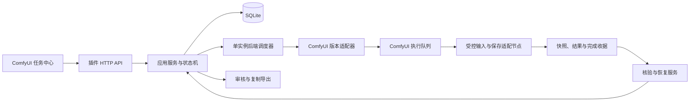

# ComfyUI Gacha Master（ComfyUI 抽卡大师）V1.0 开发规格与 Agent 执行手册

> 文档版本：1.0.0 · 编写日期：2026-11-11 · 语言：简体中文
> 项目目录：`D:\Projects\ComfyUI Gacha Master`
> 产品基线：引用对话中已确认的 V1.0 正式需求及最后一份开发总指令。
> 当前交付：仅本 Markdown 开发文档。尚未编写插件、安装依赖、安装 ComfyUI 或运行软件验收。
> “V1.0”在这里表示需求基线，不表示已经存在可下载安装的正式软件包。

## 0. 交接说明：开发 Agent 先读这里

本文件是下一位开发 Agent 的完整输入。开发 Agent 应在用户另行启动开发任务后，调查实际环境、实现插件、安装到已定位的 ComfyUI、测试、修复并交付；本次文档编写任务不执行这些操作。

开发时遵循以下优先顺序：用户在开发会话中的明确指令 → 本文件的产品规则与数据不变量 → 已安装版本的真实接口和能力 → 本文件的推荐模块组织。版本不兼容应通过适配或明确阻断解决，不得降低数据安全要求。

文档中的规则分为三类，避免把工程补充误当作用户曾经逐项确认的需求：

| 标记 | 含义 | 实施方式 |
| --- | --- | --- |
| U | 原对话中用户明确选择的方案 | 必须保留，不能自行改成另一个选项 |
| B | 最终 V1.0 总指令整合的产品基线 | V1.0 必须交付；不能因为实现困难擅自删减 |
| D | 本文补齐的工程默认值、边界与实现建议 | 直接采用；如有更可靠且同等满足需求的实现，可记录理由后替换 |

开发 Agent 的第一轮工作必须产生环境事实和关键路径验证，不能再次只写一份规划。未找到 ComfyUI 时先在合理位置查找；仍未找到则继续开发可独立测试的插件核心，并明确标注真实安装和集成验收尚未完成。不得伪称已经安装成功。

普通技术选型和可回滚的插件内修改自主完成。涉及删除用户数据、替换既有安装、升级推理环境或其他超出开发授权的操作，再说明具体影响。禁止把所有日常步骤都变成确认问题。

### 0.1 开发启动指令

可将下段连同本文件交给开发 Agent：

> 请完整阅读 `DEVELOPMENT.md`，按第 22 节的阶段门槛实际开发 ComfyUI Gacha Master V1.0。先检查实际 ComfyUI、Python、前端、节点和 API 能力，再实现可靠调度、保存与恢复。只修改本插件及明确授权的安装入口，不升级 ComfyUI 或其他插件。每个阶段运行相应检查，更新真实进度和测试证据，在没有阻塞时继续后续阶段。遇到提交结果不明时停止自动重试；遇到未验证能力时报告限制。不得用演示页面、模拟推理或未运行的测试冒充完整交付。

### 0.2 不可违反的数据不变量

1. 输入原图只读；筛选、重试、导出和卸载不删除原图。
2. 已发布的生成文件和导出文件不可覆盖；失败重试建立新 ATTEMPT。
3. 一个 DRAW 最多确认成功一次；完成次数和输出图片张数分别统计。
4. 同一插件数据空间最多有一个未核实结束的 ComfyUI 执行，包括提交结果未知的执行。
5. 提交结果未知时不自动再次 POST；`prompt_id` 不是天然幂等保证。
6. 只有证据完整的执行才记为成功；文件存在、进度 100%、HTTP 200 都不能单独证明成功。
7. 暂停、报错和重启首先禁止新调度；插件只管理归属于自己的执行。
8. 重启后可以自动核验，但必须等待用户确认才能继续提交；关闭浏览器不改变后端运行意图。
9. 工作流快照、原图身份、已分配种子和历史编号固定；恢复和筛选不能改写历史。
10. 导出冻结清单，采用复制；导出失败不回滚已经成功的抽卡。
11. 数据库异常、输出缺失和筛选状态彼此独立；缺图或未入选不触发自动重抽。
12. 数据不确定时保留证据并阻断相关调度，不猜测、不静默跳过。

### 0.3 按阶段查阅指引

首次建立整体认识，后续按下表定位，不必每轮重新加载全文。开始任何阶段前先看第 0.2 节、当前进度和已知问题，不能因局部阅读忘记全局不变量。

| 当前工作 | 重点章节 | 通过后再继续 |
| --- | --- | --- |
| 环境与关键路径 | 1—4、7、22 的 Phase 0 | 真实能力和绑定原型 |
| 输入、计划、调度、保存 | 5—11、13 | 3×5 顺序、单在途、完整保存 |
| 暂停与恢复 | 8—14、23.3 | 未知提交与全部崩溃窗口 |
| 任务中心与筛选追加 | 15—16、20、21 | 真实 UI、重连和并发操作 |
| 审核与导出 | 17—20、23 | 四种导出组合和恢复 |
| 发布与交接 | 21—25 | 真实验收与数据保护证据 |

## 1. 需求来源、已确认选择与范围

需求来源：[记录抽卡插件想法](chatgpt-conversation://6ae1ae91-8490-83e8-ab78-1eb317c9453c)。已读取该引用返回的 V0.7—V1.0 设计及最后一份 V1.0 开发总指令。旧版本与最终基线冲突时，以后者为准。

| 决策 | 来源 | V1.0 结论 |
| --- | --- | --- |
| 导出时机 | U · V0.6 → V0.7 | 同时支持临时导出和正式最终导出 |
| 导出目录结构 | U · V0.7 → V0.8 | 每批次自由选择；默认平铺，可按原图分组 |
| 多保存节点 | U · V0.8 → V0.9 | 每个工作流仅指定一个最终输出节点，由插件接管 |
| 原图保护 | U · V0.9 → V1.0 | 快照和引用两种模式均支持，默认快照 |
| 开发主线 | B · 最终总指令 | 可靠执行、双暂停、断点恢复优先，再实现工作台和导出 |
| 磁盘清理 | B / D | 默认不自动删除任务数据；未选择的清理扩展不进入首版 |

### 1.1 产品目标

用户将多张原图交给现有 ComfyUI 工作流，每张连续抽卡若干次，由后端自动排队。用户可随时查看、暂停、重启恢复、对不满意原图追加抽卡，并在原图对照界面筛选结果，最后审核导出。

标准流程：导入原图 → 绑定工作流 → 预检 → 创建固定计划 → 自动抽卡 → 对照筛选 → 追加抽卡 → 临时导出或最终审核 → 复制导出。

### 1.2 V1.0 支持范围

| 范围 | 必须支持的基线 |
| --- | --- |
| 主运行环境 | 本地单用户 ComfyUI；Windows 为首要安装验收平台 |
| 插件形态 | Python custom node 扩展 + 真正集成到 ComfyUI 的前端任务中心 |
| 输入 | 多图点击/拖拽；后端可访问文件夹的根目录图片 |
| 输入节点 | 一个明确绑定的标准 `LoadImage`，保持其 IMAGE / MASK 语义 |
| 输出节点 | 一个明确绑定的标准 `SaveImage`，PNG，可含单次 tensor batch 多图 |
| 种子 | 明确支持并检测标准 `KSampler.seed`、`KSamplerAdvanced.noise_seed` 的直接数值输入 |
| 调度 | 全局一个插件执行在途，按原图分块，支持优先/末尾追加 |
| 任务规模 | 必须通过 111 原图 × 5 = 555 DRAW；1000 DRAW 及更大计划不能受原生队列批次 UI 限制 |
| 数据 | SQLite、受控结果目录、备份、核验、恢复、可追溯日志 |
| 交互 | 中文任务中心、对照筛选、右键入选与替代按钮、双暂停、追加、导出 |

支持多个受控标准采样器时，每个种子输入都显式绑定并持久化；不通过猜测自定义节点参数实现“全兼容”。其他稳定的自定义处理节点可以随原工作流执行，但其输入输出契约和资源必须通过预检，不属于插件对其内部行为的保证。

### 1.3 明确排除的扩展

V1.0 不承诺多最终输出节点管理、动画/视频、动态图循环、多次调用输出节点的列表映射、自动识别任意随机节点、分布式调度、多 GPU 并行、跨用户共享任务、云托管适配、完整任务归档、自动删除原始结果或 AI 自动挑图。远程浏览器与后端路径的差异必须正确处理，但远程多用户部署不作为首版已验收能力。

首版仍必须具备基本分页、懒加载和缩略图，不能把千图可用性整体推迟到后续版本。

## 2. 需求编号与完成判据

| ID | 优先级 | 功能与硬性行为 | 主要验收 |
| --- | --- | --- | --- |
| R01 | P0 | 多图添加、拖拽、尾部空格、添加顺序、未执行输入移除 | Q01、Q16 |
| R02 | P0 | 文件夹根目录、稳定排序、固定清单、不递归 | Q17 |
| R03 | P0 | 默认快照 + 引用模式、哈希验证、保护源文件 | Q18、Q19 |
| R04 | P0 | 绑定原工作流副本、一个输入和一个最终输出、不改编辑器 | Q01、Q20 |
| R05 | P0 | 预分配持久化种子、任务内唯一、重试复用、追加新种子 | Q08、Q21 |
| R06 | P0 | AAAAA→BBBBB→CCCCC、自动队列、全局单在途、浏览器独立 | Q01、Q02、Q15、Q22 |
| R07 | P0 | 安全暂停、定向立即暂停或安全降级、失败停止后续 | Q03、Q04、Q12、Q23 |
| R08 | P0 | JOB/SRC/DRAW/ATTEMPT/OUT、批量输出、不可覆盖保存 | Q07、Q14、Q24 |
| R09 | P0 | SQLite 事务、单实例、完整性检查、滚动一致性备份 | Q13、Q22、Q25 |
| R10 | P0 | 异常退出、提交结果未知、文件与 DB 不一致的核验和恢复 | Q05、Q06、Q07、Q26 |
| R11 | P1 | ComfyUI 内的任务中心、准确计数、断线重连、懒加载 | Q15、Q27 |
| R12 | P1 | 左原图右结果、切换、右键/按钮入选、多选、持久化 | Q10、Q28 |
| R13 | P1 | 任意原图追加、连续编号、新种子、优先/末尾块调度 | Q09、Q29 |
| R14 | P2 | 运行中临时导出、不改变调度、仅复制当前入选项 | Q11、Q30 |
| R15 | P2 | 最终审核、明确跳过、冻结版本、平铺/分组、可恢复导出 | Q11、Q30、Q31 |
| R16 | P0/P2 | 路径限制、磁盘不足、损坏、保守清理、安装升级卸载保数据 | Q14、Q19、Q32—Q35 |

P0/P1/P2 是实施次序，均属于 V1.0 交付范围；只完成 P0 只能称为阶段成果。

## 3. 环境调查与能力适配

### 3.1 开发开始时记录的事实

在 `docs/ENVIRONMENT.md` 记录：操作系统、ComfyUI 真实路径、Git commit/发行版本、前端包版本、启动方式与监听地址、Python 可执行文件、Python/SQLite/PyTorch/Pillow 版本、GPU/显存、custom_nodes 路径、输入/输出/用户目录、相关插件、可用模型、测试工作流及启动日志。

本次已知信息仅为：文档工作区在 Windows 的 `D:\Projects\ComfyUI Gacha Master`，编写前该目录为空；未发现本工作区及其父级的 `AGENTS.md`。未调查实际 ComfyUI 安装，不得据此填写安装位置、模型或版本。

环境调查必须区分 ComfyUI 自带 Python、便携包 Python、虚拟环境及系统 Python，不能把依赖安装到错误解释器。先读已有仓库指令和 Git 状态，再决定工程组织；不覆盖用户已有修改。

### 3.2 已核对的官方资料与适用边界

下表为 2026-11-11 查阅的资料。分支源码会变化，开发时还需记录实际安装版本对应的 commit；官方主分支能力不等于本机能力。

| 资料 | 查阅得到的事实 | 对本项目的约束 |
| --- | --- | --- |
| [ComfyUI Server Routes](https://docs.comfy.org/development/comfyui-server/comms_routes) | 提供 prompt、queue、history、WebSocket 和自定义路由机制 | 封装服务器交互，不依赖浏览器驱动调度 |
| [官方 server.py](https://github.com/Comfy-Org/ComfyUI/blob/master/server.py) | 查阅版本同时含按 job ID 取消、`/interrupt`，并接受客户端 prompt UUID | 不写死“旧接口已全部移除”；逐版本检查语义 |
| [官方 execution.py](https://github.com/Comfy-Org/ComfyUI/blob/master/execution.py) | 存在执行成功/异常事件、队列历史和按 ID 检查并中断的锁内操作 | 终态判定、事件过滤与取消竞态均需真实测试 |
| [JavaScript 扩展](https://docs.comfy.org/custom-nodes/js/javascript_overview) | `WEB_DIRECTORY` 和 `app.registerExtension` 为扩展入口 | 使用正式扩展机制 |
| [Sidebar Tabs](https://docs.comfy.org/custom-nodes/js/javascript_sidebar_tabs) | 提供侧栏扩展文档 | 优先接入已安装版本支持的侧栏/面板 API |
| [Custom Node Properties](https://docs.comfy.org/custom-nodes/backend/server_overview) | V1 节点定义仍有支持，另有 V3 定义；执行有缓存机制 | 注册方式按安装版本选定；输出身份必须参与缓存键 |
| [官方 nodes.py](https://github.com/Comfy-Org/ComfyUI/blob/master/nodes.py) | 标准输入含 IMAGE/MASK；保存节点具有自己的命名和返回契约 | 适配器必须保留实际节点契约，不能只改文件前缀 |
| [SQLite WAL](https://www.sqlite.org/wal.html)、[同步设置](https://www.sqlite.org/pragma.html#pragma_synchronous) | WAL 涉及附属文件和本机共享内存；FULL 加强事务持久化 | 活跃 DB 放本地文件系统，验证实际 PRAGMA；不承诺硬件绝对零丢失 |
| [SQLite Online Backup](https://www.sqlite.org/backup.html)、[Python sqlite3](https://docs.python.org/3/library/sqlite3.html#sqlite3.Connection.backup) | 可通过一致性备份 API 复制运行中的数据库 | 不直接复制活跃的单个 `.db` 冒充完整备份 |

本文之后的状态机、表约束、目录布局和默认参数为本项目工程设计，不是官方 API 承诺。

### 3.3 能力探测契约

后端提供只读 `capabilities`，至少包括：

```json
{
  "schema_version": 1,
  "comfy_version": "detected-at-runtime",
  "frontend_version": "detected-at-runtime",
  "client_supplied_prompt_id": false,
  "targeted_cancel": "unverified",
  "queue_lookup": false,
  "history_lookup": false,
  "execution_events": false,
  "load_image_binding": "unverified",
  "save_image_binding": "unverified",
  "filesystem_no_replace_publish": false,
  "warnings": []
}
```

`targeted_cancel` 允许 `verified_atomic` / `unsupported` / `unverified`。HTTP 路由存在、OPTIONS 成功或版本号达到阈值，都不能单独把它提升为已验证。

优先评估安装版本的 `POST /api/jobs/{job_id}/cancel`。若使用旧版带 `prompt_id` 的 `/interrupt`，必须确认“检查运行 ID”和“发出中断”不会在两个任务切换之间误伤外部任务。仅在插件侧先 GET 当前任务再调用全局 interrupt，仍存在竞态，禁止作为替代方案。

不能安全定向中断时，立即暂停按钮仍可记录停止意图并禁止后续提交，明确提示“当前版本无法安全定向中断，等待本次结束”。不隐藏限制，不回退到全局中断。该降级可以发布，但必须在能力表和测试报告中公开。

自定义 `prompt_id` 不受支持时，适配器仍需在提交前保存本地 attempt UUID，并将身份放入保存适配器和可查询的执行元数据。响应成功后保存远端 ID。响应丢失且无法按身份核验时进入 UNKNOWN；不得为“兼容旧版本”而无提示重试。若关键关联链无法建立，则预检阻止运行。

## 4. 推荐架构与工程组织

### 4.1 模块责任



后端运行于 ComfyUI Python 进程，生命周期独立于浏览器。使用一个协调器负责调度、暂停意图和执行归属；文件核验、缩略图、备份、导出放入有界工作线程或任务，避免阻塞服务器事件循环。

默认采用 Python 标准库 SQLite、aiohttp 及 ComfyUI 已有图像依赖；前端采用模块化 JavaScript ES modules。需要 TypeScript/Vite 时记录收益并提交可直接加载的构建产物，不要求用户运行 Node 开发服务器。不引入独立数据库服务、消息队列或另一套推理引擎。

### 4.2 建议目录

```text
comfyui_gacha_master/
  __init__.py                  # 节点/前端/路由入口，轻量注册
  pyproject.toml               # 项目元信息、开发工具配置
  requirements.txt            # 仅必要的额外运行依赖
  backend/
    api.py                    # 参数校验、错误映射、HTTP 契约
    service.py                # 事务边界、用户操作
    scheduler.py              # 单实例、块选择、单在途、暂停屏障
    states.py                 # 状态和合法转移
    repository.py             # 参数化 SQL、约束、读写协调
    schema.py                 # schema 版本与迁移
    adapters/comfy.py          # 版本能力、提交、查询、定向取消
    workflow.py               # 捕获、预检、深复制转换、种子绑定
    inputs.py                 # 上传、清单、快照、引用核验
    storage.py                # 路径约束、无覆盖发布、收据、哈希
    recovery.py               # 核验、证据归并、恢复决策
    exports.py                # 审核、冻结、复制、断点恢复
    backups.py                # 一致性备份、轮转、恢复检查
    thumbnails.py             # 可重建缓存
  nodes/
    load_image.py             # 执行副本中的受控输入适配
    save_image.py             # 执行副本中的受控保存适配
  web/
    extension.js              # 唯一扩展入口
    api.js
    state.js
    components/               # 任务配置、任务列表、源图行、对照、审核
    styles.css                # 限定在插件根容器内
  tests/
    unit/
    integration/
    fault_injection/
    e2e/
    fixtures/                 # 小型原创测试图和工作流
  docs/
    ENVIRONMENT.md
    ARCHITECTURE.md
    DEVELOPMENT-STATUS.md
    TEST-REPORT.md
    KNOWN-ISSUES.md
  examples/
  DEVELOPMENT.md
  README.md
  CHANGELOG.md
```

这是开发建议，不要求现在创建空目录或占位文件。模块可以合理合并，但不允许单个巨型文件同时处理 HTTP、SQL、调度、保存和 UI。本文兼任原总指令要求的开发计划，不必复制另一份容易漂移的计划；实际开发再维护状态、架构、测试和已知问题文档。

### 4.3 存储位置

安装代码与持久数据分开，避免更新或卸载插件时丢任务。

```text
<data_root>/                       # 默认：实际 ComfyUI 用户目录/gacha_master
  config.json
  db/gacha.sqlite3                 # 本地磁盘，非同步盘/网络共享活跃 DB
  backups/                         # 最近 5 份校验通过的 DB 备份
  inbox/<upload_id>/               # 尚未完成任务认领的上传
  jobs/<job_uuid>/
    workflow_ui.json
    workflow_api.json
    bindings.json
    plan.json                      # 创建完成的计划检查点
    sources/<source_uuid>/...      # 默认快照；引用模式没有持久原图副本
    receipts/<attempt_uuid>/...    # 文件完成/执行终态收据
  logs/

<results_root>/                    # 默认：ComfyUI output/gacha_master/Jobs
  JOB-20261111-<id>/
    SRC-0001/
      DRAW-000001/
        ATTEMPT-001-<id>/
          OUT-0001.png
          OUT-0002.png
          outputs.complete.json
    thumbnails/                    # 允许显式清理、可重建
    manifest.json                  # 恢复辅助信息，带版本和校验

<用户指定的 export_root>/
  QUICK-20261111-<export_id>/...
  FINAL-20261111-<export_id>/...
```

`data_root`、`results_root`、`export_root` 都应持久化解析后的绝对路径。相对路径仅在确定的根目录内部使用。运行中不得直接修改根目录配置；迁移必须先暂停、备份、核验并重新登记路径。数据路径不能只存浏览器 localStorage。

## 5. 领域模型、编号与进度

### 5.1 身份定义

| 名称 | 含义与作用域 |
| --- | --- |
| JOB | 一份固定工作流和输入清单的抽卡任务；内部用完整 UUID，显示短标签 |
| SRC | JOB 内原图身份；有稳定 UUID 和从 1 开始的展示序号 |
| BLOCK | 同一原图一批连续计划，如初始 5 次或追加 5 次 |
| DRAW | SRC 内逻辑抽卡序号；分配后不复用、不重排 |
| ATTEMPT | DRAW 的一次实际尝试；重试递增，具有独立 UUID 与远端执行 ID |
| OUT | ATTEMPT 中第几个输出，按输入 tensor 的 batch 顺序编号 |
| EXPORT | 一个独立临时/正式导出批次，冻结自己的输出和审核清单 |

显示编号补零不构成数量上限。原图删除、失败或重试不回收编号；重复文件名和相同内容的两次导入也默认视为两个 SRC，不自动去重。可以提示重复，但不能自行改变用户指定的次数。

DRAW 编号按“已经分配的最大序号 + 1”追加，不能按成功次数计算。例：SRC 已规划 1—5，但只完成 1—2，此时追加 5 次仍分配 6—10。实际执行顺序可因用户优先追加而与编号不同，历史界面可分别查看编号顺序和执行时间。

内部原始文件路径必须包含 ATTEMPT 身份，不能只用 `DRAW-0001_OUT-01.png` 覆盖重试文件。导出文件名可使用 `SRC-0001_DRAW-000006_ATTEMPT-002_OUT-0001.png`；批次目录保证跨任务隔离。

### 5.2 进度口径

同时显示：原始计划数、追加数、用户移除而取消数、有效计划数、成功 DRAW、在途 DRAW、待执行 DRAW、失败/中断待重试 DRAW、UNKNOWN DRAW、可用 OUT 和异常 OUT。

有效计划数 = 原始计划 + 追加 − 用户明确取消的未执行计划。每个 DRAW 在汇总状态中只计一次。重试次数另算；5 DRAW 每次产 4 OUT，应显示 5 次成功、20 张结果。筛选两张后仍是 5 次成功。

完成状态与文件健康分离：已经成功的 DRAW 后续丢图时仍保留历史完成事实，输出标记 MISSING/CORRUPT，阻止将坏文件作为可用入选结果导出，不把历史自动退回 PENDING。

所有时间内部保存 UTC，界面按用户时区显示；队列顺序使用递增序号，不能依赖墙上时钟排序。

## 6. 图片导入、快照与引用

### 6.1 多图模式

初始一个空白格；点击或拖入后显示预览并在尾部补一个空白格。一次选择多张图片保留 FileList 顺序；多次添加按用户操作序号合并，不能按异步上传完成顺序排列。不自动压缩或改写用户原图。

浏览器上传保存到后端受控 inbox，使用 upload token 认领；`File.name` 不是服务器绝对路径。浏览器文件没有可持久访问的原路径，因此此入口使用快照模式；用户选择引用模式时须改用后端可访问路径，不得假装建立浏览器本地文件引用。

草稿可自由移除和重排。任务冻结后仍允许移除完全未提交的原图：要求其所有 DRAW 从未进入 DISPATCHING、无 attempt 和输出；事务中将 SRC 标记 `REMOVED_BY_USER`、相关 DRAW 标记取消并记录事件，不硬删除历史或重排其他编号。已经执行过的 SRC 不提供普通“移除输入”操作。

### 6.2 文件夹模式

用户输入/选择后端可访问目录，后端必须先检查它位于明确允许的输入根目录内。可通过设置界面登记输入根目录，不提供任意磁盘文件浏览 API。上传的相对文件夹路径不能当成服务器路径。

只枚举该目录直接包含的普通图片文件，不递归、不跟随子目录或链接跳转。扩展名白名单与实际解码双重检查。V1.0 基线为静态 PNG、JPEG、WebP；实际解码器不支持的格式或多帧文件在导入时明确拒绝，不默取第一帧。

默认排序（D）：按文件名做 Unicode NFC 和 casefold 后的自然排序，数字段按数值比较，再用原文件名 UTF-8 字节序作稳定平局项。显示完整预览顺序后冻结 `source_order`；恢复直接读保存的清单，不重新扫描排序。新增文件不加入，原有引用缺失则按引用规则报错。

文件夹导入发现无效图片时提供“修正后重试”或“明确排除此文件再创建”的预览，不能静默少导入。快照复制前后检测源文件是否变化，导入时尚在写入的文件不能被当作稳定输入。

### 6.3 快照模式（默认）

创建任务时把所有原图逐一复制到受控任务目录，使用临时文件、SHA-256 和实际解码检查。源/目标哈希一致、大小一致，全部源图完成后才允许 READY。不能先抽前几张，再悄悄处理后面的失败快照。

复制过程中源文件变化则阻断创建并说明哪张异常。快照保留原始字节，预览的 EXIF 方向处理由解码/显示完成，不能通过改写原图解决。源文件之后移动、删除或变化不影响已验证快照；每次实际使用的快照仍需验证。

创建过程中崩溃保留 `CREATING` 与已完成的检查点，重启后核验再继续或由用户放弃创建，不留下半份 READY 计划。

### 6.4 原路径引用模式

保存绝对路径、原文件名、大小、mtime、SHA-256、尺寸及解码信息。每次执行和恢复均验证真实输入字节；只比文件大小/mtime 不足以替代哈希。

避免“校验后文件又被替换”的时间窗口：尽量读取一次受控文件句柄，将同一份读入的字节用于哈希和解码；否则在读取前后验证并阻断变化。可以使用内存缓冲，不得在后台建立未说明的永久原图快照。

源文件丢失时允许用户重新定位，只有新路径的 SHA-256 与原记录一致才更新引用路径并记录事件。内容不同则恢复旧输入或新建任务，不能强行把同名新文件接到旧 SRC 上。

## 7. 工作流捕获、适配与随机种子

### 7.1 捕获与预检

同时保存 UI 工作流 JSON（供复现编辑器）和 API prompt JSON（供真正执行），不能假定两者结构相同。使用安装版本的图导出 API，只捕获副本；不要通过模拟点击原生 Queue 按钮提交任务。

冻结时保存两个快照的规范化哈希、节点 ID/类型/输入定义、输入和输出绑定、种子绑定、插件版本及工作流依赖摘要。后续每次执行从该快照深复制；用户在画布继续编辑不会改变已有任务。调整工作流应新建 JOB。

预检至少验证：

- 选中的 LoadImage 和 SaveImage 存在、启用且可映射到 API 节点 ID。
- 所选输入实际处于所选最终输出的上游依赖路径中，避免原图从未参与结果。
- 模型和文件资源可用、必需节点已注册、连线/输入合法；缺失节点列出 ID、类型和处理方法。
- 所有实际参与最终结果的受控随机输入均可识别和绑定；不存在未处理的动态随机输入。
- 所选保存节点的批量和返回值契约可被适配；额外保存/其他外部副作用节点列出。
- 工作流输入/输出结构、文件空间、路径权限、SQLite 和调度器能力均满足运行要求。

额外 SaveImage 等节点保持原工作流行为，预检明确列出“会额外保存，不纳入插件管理”的警告，由用户在创建时知悉。不能为省磁盘擅自删节点，也不能保留选中原保存节点后再加一个新保存节点造成同一输出双份保存。

模型文件默认记录解析后的身份、大小和 mtime，必要时记录哈希；不要每次对几十 GB 模型重复哈希。工作流快照不等于模型/LoRA/第三方节点完整备份。发现依赖身份或节点契约变化时暂停，恢复原环境或新建任务；不得宣称相同种子跨环境必定像素一致。

### 7.2 输入适配

优先通过受控路径接入原 LoadImage；若原生输入验证、引用模式或缓存策略无法安全满足，则只在执行副本中把绑定输入替换为插件的 `GachaLoadImage` 适配节点。

适配节点接收后端发放的 source/attempt token，不接受任意客户端绝对路径。必须保留安装版本 LoadImage 的 IMAGE/MASK 输出顺序、透明通道与方向语义、尺寸及精度约定。不能让依赖 MASK 的工作流失效。调用既有解码工具或封装原生实现，避免复制整套 ComfyUI 源码。

同一引用内容变化必须触发检查，不能让 ComfyUI 缓存绕过原图校验。输入的 source hash/身份应参与缓存判断；执行前和实际解码时均有防护。

### 7.3 输出适配

在执行副本中原位置替换选中的 SaveImage，保持它的上游图链；适配器按安装版本兼容其返回值，若下游有合法连线也要保持。无法兼容的契约在预检报错，不能假定所有版本 SaveImage 都没有返回输出。

`GachaSaveImage` 只按后端已登记的 job/source/draw/attempt 身份保存，不从未经校验的 JSON 字符串拼绝对路径。attempt UUID 必须是影响输出节点缓存键的真实输入，防止同种子重试复用旧执行的保存记录；不能依赖修改隐藏元数据来使缓存失效。

V1.0 接收一次调用中的一个 IMAGE tensor batch，先获取应保存数量 N，再保存 N 张。零张输出为失败。若输出节点因列表映射/动态展开被多次调用，V1.0 不将第一次调用误认作全部完成：能预判则禁止，运行时发现则停止并保留异常证据。要扩展此能力，必须先实现多调用输出编号与汇总协议并加验收。

### 7.4 种子分配

种子在 DRAW 可提交前分配并落库，重启不重新随机。默认在所有绑定节点允许范围与 `[0, 2^53-1]` 的交集内使用安全随机整数；对外 JSON 用十进制字符串，避免前端精度丢失。适配器最后转换为 Python int，SQLite 用 INTEGER 保存可精确覆盖该默认范围。

同 JOB 的每个受控种子值在所有 DRAW/绑定之间唯一，数据库设置唯一约束并在冲突时重新分配。每个 DRAW 保存完整 `node_id + input_name → seed` 映射，不只保存一个 UI 展示值。

多个标准采样器可以显式绑定多组数值；首版不自动拆除连接着种子生成节点的连线。动态随机节点、未识别的随机参数、无法确定的子图种子会阻止启动并说明原因。禁用加噪且不消费种子的节点应显示为不受控/无效绑定；生产抽卡至少需要一个有效随机绑定。

重试复用原 DRAW 的全部种子；追加分配新 DRAW 和新种子。前端 `control_after_generate` 的增减逻辑不参与后端计划。不同种子不保证图像必然不同，同种子也不保证不同软硬件环境完全复现。

## 8. 调度顺序、单实例与暂停屏障

### 8.1 基本调度规则

默认同时只允许一个 JOB 处于运行意图；可以浏览多个历史 JOB，但启动第二个时返回当前占用者和处理方式，不在后台自动切换任务。全插件最多一个未核实结束的 ATTEMPT，不只是“每个 JOB 一个”。

初始计划按 `source_order` 生成 BLOCK，每块包含该 SRC 的全部初始 DRAW，块内按 DRAW 序号执行。必须得到 A1 A2 A3 A4 A5 → B1…B5 → C1…C5。插件一项一项提交，不一次塞入 555 项 ComfyUI 队列；用户不需要设置原生队列批次数。

一个执行成功、全部输出核验且数据库提交完成、远端执行确认离开运行/待执行集合后，才释放在途槽并取下一项。外部任务可以正常插在 ComfyUI 的全局队列中，插件不通过 `front=true` 抢占外部任务。

创建计划可分批入库，例如每批 500 DRAW，但 JOB 在清单、快照、种子和计划全部完成前保持 CREATING。中途崩溃后根据检查点幂等补齐，不重新分配已经保存的种子。

### 8.2 追加 BLOCK 的确定顺序

每次追加建立独立 BLOCK，包含一个 SRC 的正整数次新 DRAW，优先级是 `PRIORITY` 或 `TAIL`，同优先级按请求落库序号 FIFO。

- 优先追加：当前在途 DRAW 结束后，先取优先待执行块，再继续原初始块的剩余部分。
- 末尾追加：放在当前所有待执行块之后；后续新优先块仍可以先执行。
- 已开始的追加块保留连续执行权；后来的优先请求排在它之后，不能把该追加块拆成几个交替片段。
- 暂停/失败可以打断块的时间连续性；恢复时保留块内游标和优先队列顺序。
- 初始块因用户明确选择优先追加而暂时让位，是默认原图顺序的显式例外；没有这类操作时必须严格按原图连续执行。

这是为同时满足“优先待执行”和“同批追加连续生成”采用的 D 规则。UI 提示优先追加不抢占已经开始的另一追加块，不承诺中途抢走 GPU。

例：A1、A2 执行后追加 C6—C8 且选择优先，得到 A1 A2 → C6 C7 C8 → A3 A4 A5 → B1…；C6 执行中再收到 D 的优先追加，则先做完 C6—C8，再处理 D。

### 8.3 单实例和并发控制

协调器在 ComfyUI 服务器就绪后启动，不能在 import 时直接进入调度循环。通过适配的生命周期入口启动；没有适合的公开回调时可在首次 API 初始化服务，但初始化必须加锁且不能依赖持续打开的页面。

对规范化 `data_root` 获取跨进程 OS 文件锁，Windows/Linux 分别使用经验证的锁实现。PID 文件只用于诊断，不作为排他锁；另一个实例不能仅凭心跳超时就抢占仍持锁的进程。获取锁失败时只读展示错误并禁止调度。

数据库设置单槽 `execution_slot`，CLAIM DRAW、创建 ATTEMPT、写入提交意图和占用槽在同一事务中完成。每次服务启动有 boot/owner UUID，状态更新校验 owner、attempt 和行版本，拒绝旧事件串写新执行。

暂停请求与“领取下一项”的决定必须在同一协调器的串行边界中排序。已处理的停止意图不能被另一个提交循环越过。不要用增加 sleep 或仅在按钮禁用状态中实现互斥。

本锁保障同一数据空间；不同 `data_root` 代表独立插件实例。V1.0 不支持它们共同管理同一批结果，路径检查应阻止明显的共享写目录配置。

### 8.4 双暂停的精确定义

| 操作时机 | 安全暂停 | 立即暂停 |
| --- | --- | --- |
| 尚无在途项 | 落库停止意图，直接 PAUSED | 同左，不发送全局中断 |
| 正在领取/提交 | 停止下一项；提交决定已发生则等待该项核实结束 | 同时按 attempt 身份核实是否已接收，再决定定向取消 |
| 已在远端排队、未运行 | 默认让这一个已投递项完成后暂停 | 能力允许时只取消该 prompt/job ID |
| 正在执行 | 当前完整执行、保存和记账后暂停 | 记录意图并对本插件 ID 发出经验证的定向取消 |
| 正在核验/写数据库 | 等待本项提交完毕再显示 PAUSED | 先完成安全核验，不把保存一半当作成功 |
| 提交/执行结果未知 | 保持 RECOVERY_REQUIRED，不把它说成“安全暂停完成” | 同样保持待核实，不能通过重复取消/重提猜状态 |
| 不支持安全定向取消 | 正常工作 | 停止后续提交并明确降级为等待当前结束 |

按钮请求成功表示意图已经持久化，响应返回实际状态，不能马上显示“任务已中断”。直到确认目标离开执行/队列且相关文件核验结束，才显示“已暂停”。若用户请求时执行已经正常完成，保留成功，不因迟到的取消响应改成中断。

安全暂停只保证当前一个插件投递项完成，不等于把整个原图 BLOCK 执行完。所有执行错误、OOM、输入变化、保存错误和无法核实的提交都阻止后续 DRAW；不自动重试、不自动降低参数或换模型。

## 9. 状态机与合法转换

状态需要由一个模块定义并集中校验。前端文本不能成为后端状态来源。状态变化、原因、操作者、关联身份和事件序号一起提交。

### 9.1 JOB 状态及运行意图

| 状态 | 说明 | 可以离开的条件 |
| --- | --- | --- |
| CREATING | 导入、快照和计划尚未完整 | 全部就绪进入 READY；错误阻断创建 |
| READY | 计划完整，尚未运行 | 用户启动且预检通过 |
| RUNNING | 用户已授权当前会话持续调度 | 暂停、错误、重启或全部有效计划完成 |
| PAUSING | 已记录停止意图，仍在收尾 | 本项核实完毕进入 PAUSED；异常进入 BLOCKED/RECOVERY_REQUIRED |
| PAUSED | 没有未知在途项，已停止调度 | 用户恢复并通过预检 |
| BLOCKED | 有已确定的错误需要修复/重试 | 处理原因后明确恢复；不自动跳过错误项 |
| RECOVERY_REQUIRED | 重启核验或有状态未知项 | 核验/人工决策后回到 PAUSED 或已完成状态 |
| COMPLETED | 当前全部有效 DRAW 已成功 | 追加后变为 PAUSED，用户明确继续 |

另存 `run_intent = STOPPED / RUN / PAUSE_SAFE / PAUSE_NOW`。重启后无条件清除自动运行授权，保持 STOPPED；但已经留在远端运行的旧执行仍要监测收尾，不能假装远端也停止了。

导出不改变 JOB 执行状态；“最终导出成功”和“所有抽卡完成”是两件事。

进入 COMPLETED 必须同时满足没有未核实在途项、全部有效 DRAW 已成功，并将 run_intent 设为 STOPPED。追加计划不能继承上一次已经结束的运行授权。

### 9.2 DRAW / ATTEMPT 状态

```text
PENDING -> CLAIMED -> DISPATCHING -> QUEUED -> RUNNING -> VERIFYING -> SUCCEEDED
                              \-> UNKNOWN
              QUEUED/RUNNING -> INTERRUPTED / FAILED / UNKNOWN
              VERIFYING -> FAILED / UNKNOWN
FAILED/INTERRUPTED --用户确认重试--> PENDING（同 DRAW，新 ATTEMPT）
UNKNOWN --证据核实或人工决策--> SUCCEEDED / FAILED / INTERRUPTED / 保持 UNKNOWN
```

执行开始/结束事件可能先于 HTTP 提交响应到达，所以不能强制只接受单一路径：例如 DISPATCHING 可被匹配的执行开始事件推进到 RUNNING。所有事件只能推进当前 attempt 的证据，旧响应不能把 RUNNING 回退为 QUEUED，也不能把 SUCCEEDED 改回运行中。

`CLAIMED` 尚未跨越外部提交边界，可在证明尚未发送时恢复为 PENDING；进入 DISPATCHING 表示可能已发生外部副作用，重启后不能简单退回。`CANCELLED_BY_USER` 仅用于第 6.1 节明确移除的从未执行计划。

DRAW 保存 `accepted_attempt_id`，一旦成功即锁定。ATTEMPT 历史保留，不复用远端 prompt ID；新尝试使用新 UUID。同一 DRAW 的多个失败尝试不增加成功计数。

### 9.3 独立的输出和导出状态

输出健康：`STAGED / VERIFIED / PARTIAL / MISSING / CORRUPT / QUARANTINED`。输出是否可筛选还要求它属于 DRAW 已接受的成功 ATTEMPT。保存了一部分完整 PNG 并不等于该 DRAW 已完成。

导出：`DRAFT / FROZEN / COPYING / COMPLETED / PARTIAL_FAILED / RECOVERY_REQUIRED`。单个 export_item：`PENDING / COPYING / VERIFIED / FAILED`。重复恢复同批次不得增加冻结数量。

## 10. 提交协议与幂等边界

### 10.1 正常提交顺序

1. 检查 run_intent、暂停屏障、全局槽、工作流能力及输入健康。
2. 事务中领取 DRAW，创建 attempt UUID，保存期望 prompt UUID、源哈希、种子映射、执行副本哈希，分配独占结果目录并占用槽。
3. 提交前持久化 DISPATCHING/提交意图；失败则不调用 ComfyUI。
4. 用冻结工作流副本替换受控输入、种子和输出身份；只发送一次 `/prompt` 请求。HTTP 客户端、代理和装饰器均关闭 POST 自动重试。
5. 提交成功时保存服务端返回的真实 ID 和映射；已支持客户端 ID 时核对一致性，不假定服务端一定原样使用。
6. 后端自己的连接接收执行事件，并查询 queue/history 对账。所有消息按 prompt ID、attempt token 和归属过滤。
7. 成功终态 + 完整输出核验后，事务中写 outputs、接受 attempt、成功 DRAW、事件和汇总；确认远端不再活动后释放槽。
8. 再检查暂停/错误意图，才决定下一项。

输出节点接收的身份信息只含本插件需要的字段；不能把认证 token、任意路径授权或未过滤的敏感配置嵌入 PNG 工作流元数据。

### 10.2 提交失败分类

| 证据 | 处理 |
| --- | --- |
| 请求发出前本地校验失败 | 可证明未提交；记录原因并 BLOCKED |
| 服务端明确返回节点验证拒绝且没有入队 | FAILED，保留错误详情；人工修复后新 attempt |
| 确认连接尚未建立且没有发送任何请求字节 | 可按适配器证据认定未提交，但仍停止本轮调度 |
| 超时、连接重置、未知 5xx、响应损坏 | UNKNOWN；不能用状态码/超时推断未接收 |
| 远端存在匹配 ID 的 queued/running | 继续跟踪同一 attempt，不再提交 |
| 远端历史匹配且成功、文件完整 | 完成核验和记账，不重复执行 |
| queue/history 均查不到 | 不等于“从未执行”；核对收据、文件、实例和历史保留情况 |

重连 GET 可以有界重试，任何等待都保持停止新提交。历史可能已清理、保存在内存或跨进程丢失，因此“查不到”不能作为安全重提证明。

### 10.3 面向浏览器操作的幂等

创建 JOB、启动/恢复、追加 BLOCK、创建/确认导出、人工核实决策都带 `Idempotency-Key`，后端按操作作用域 + key 保存请求摘要和结果。同 key 同内容返回原结果，同 key 不同内容返回 409。前端双击、超时后重发和多个标签页不产生两份追加计划或两份导出。

筛选使用“将 selected 设置为 true/false”的 PUT，不使用不可重放的 toggle 接口。增删、审核确认和恢复使用 expected_version 乐观并发控制。鉴权/参数校验失败不能占用有效操作的幂等结果。

数据库提交和 HTTP 发送无法构成跨系统原子事务。本项目保障“完成记账唯一”和“未知状态不自动重提”，不承诺所有硬件/外部插件故障下物理推理绝对只发生一次。

## 11. 输出可靠保存与完成证明

### 11.1 保存协议

每个 ATTEMPT 使用独占目录。保存开始先记录 N 张预期输出及身份，依次执行：

1. 在最终目录同一文件系统内创建独占临时文件，文件名不来自原图的未过滤名称。
2. 从生成 tensor 编码 PNG，保存必要生成参数和可追溯 ID；尊重用户关闭敏感工作流元数据的设置。
3. flush + 可用的 fsync/对应平台持久化措施，关闭文件；重新解码验证格式、尺寸、完整像素数据，计算字节数和 SHA-256。
4. 通过经过测试的“不覆盖发布”操作把临时文件发布为正式 OUT 名称。可以采用同卷独占链接发布/Windows 无覆盖重命名等方式；不把会覆盖目标的 `os.replace` 当作安全检查。
5. 所有 N 张均成功后，最后原子发布 `outputs.complete.json`，包含完整有序清单、N、各文件哈希、大小、尺寸、job/source/draw/attempt、源哈希和执行副本哈希。
6. 可用时同步目录项；记录平台能力和限制。不能承诺 Python fsync 绕过故障硬件、控制器缓存或所有文件系统语义。

若同一 attempt 的保存步骤意外重放，仅在能够证明属于同一次调用、且身份和内容全部一致时，才可认领既有完整清单返回同一结果；否则报错。列表映射的第二次真实调用不能被伪装成幂等重放；安装版本无法区分时保守拒绝。不能追加一份新 OUT 使同一次逻辑结果翻倍。目标已存在但内容不同就隔离并停止，不自动另起文件名掩盖异常。

V1.0 的安全原子发布基线为经验证的本地文件系统。跨卷移动、SMB、同步盘等未经验证的结果目录应预检拒绝或明确为未支持，不用复制后删源模拟原子操作。

### 11.2 完成证据链

确认 DRAW 成功同时需要：

- 身份匹配的 ComfyUI 工作流成功终态证据；仅 `executed` 某节点或 `executing: null` 不够。
- 指定输出节点的完整输出清单，N > 0，全部文件解码、大小和哈希一致。
- 清单、源哈希、工作流哈希、种子/attempt 归属一致；没有未处理的另一轮输出调用。
- 数据库成功事务完成，且该 DRAW 尚未接受其他成功 attempt。

后端收到成功/失败/中断终态后，应先持久化精简终态收据，再完成汇总记账；该收据必须来自受控事件/历史查询，不允许浏览器任意上传“成功证明”。文件完成收据和执行终态收据相互独立，便于恢复最后一次 DB 提交前的执行。

如果选中的输出已保存，但同工作流其他节点失败，DRAW 整体仍为失败，已保存文件保留为 PARTIAL 证据。首版不把这类部分结果自动纳入正常入选与正式导出。

没有足够终态证据时，即使所有 PNG 都完整，也只显示“文件已找回，执行终态待核实”；不能单凭图片断定其他节点没有失败。

### 11.3 辅助清单的边界

`manifest.json`、计划检查点和完成收据带 schema_version、生成时间、身份和校验信息，发布时使用临时文件与原子提交。SQLite 是正常运行时的业务状态源，文件是实际产物证据；两者不一致时必须对账。

清单可协助找回输出和 attempt，但不保证重建最后一次筛选、追加或审核操作。数据库及备份均丢失时进入专门的只读抢救流程，不能把扫描文件后猜出的任务宣称为完整恢复。

## 12. 重启核验与断点恢复

### 12.1 启动恢复顺序

1. 获取单实例锁，建立新的 boot ID，禁止任何新 DRAW 提交。
2. 检查配置、数据根身份、schema、SQLite 完整性和外键；失败则进入只读诊断。
3. 找出 CREATING、运行中、提交中、核验中和未完成导出的记录，标记需要核验。
4. 按 attempt 查本地收据、结果实际文件、远端 queue/history/job API；记录检查时间和证据来源。
5. 重建明确的完成记录或保留 UNKNOWN，生成逐项恢复报告；所有修复事件可追溯，不能静默改账。
6. 向用户显示：确定完成、确定未提交、确定失败/中断、远端仍在运行、文件异常、无法确定、未完成导出。
7. 用户确认处理方式后，仅对安全可继续的计划恢复运行。恢复前再次检查输入、能力和占用槽。

关闭再打开网页不触发上述“进程重启停止授权”；只要后端没有重启，按原运行意图继续。后端重启即使上次正常关闭也不能自动续抽。

### 12.2 证据决策表

| DB / 外部证据 | 恢复结论 | 是否可自动重提 |
| --- | --- | --- |
| PENDING，且从未越过提交边界 | 未执行，保留原计划和种子 | 用户确认恢复后可以 |
| 匹配 queued/running | 同一 attempt 仍存活，接管监测 | 不可以 |
| 历史/受控终态收据成功 + 完整输出 | 幂等补记成功，报告已找回 | 不可以 |
| 文件完整，但没有可靠成功终态 | 输出待核实，保留 UNKNOWN | 不可以 |
| 明确失败/中断，且已确认不再活动 | 待用户重试，同 DRAW/种子，新 ATTEMPT | 不自动；确认后可以 |
| 历史成功但缺少任一 OUT 或哈希错 | 输出损坏/缺失，阻断并提供定位/修复 | 不可以自动把缺图当新 DRAW |
| DB 已成功，文件后来丢失 | 保留完成事实、标记输出异常 | 不可以 |
| 提交中断且远端查不到、无完整证据 | UNKNOWN | 不可以 |
| 文件/收据身份与 DB 不匹配 | QUARANTINED，报告冲突 | 不可以 |
| 备份早于若干已发布文件 | 扫描清单对账；找不回的选择标明未知 | 不可以盲目跑完旧计划 |

### 12.3 UNKNOWN 的人工处理

界面按 attempt 显示时间线、提交 ID、源图、种子、工作流、现有文件、远端查询结果和风险。提供以下具体操作：

- 重新核验/继续等待；有远端活动项时优先提供此项。
- 找回同身份完整文件或选择有效备份，完成重新校验。
- 明确认定放弃旧尝试并重新执行该 DRAW：要求确认旧执行不再活动；保存确认理由，关闭旧 attempt、保留旧文件，再创建新 ATTEMPT。历史已丢失时提示可能曾经运行过，不能把这一决定描述成自动去重成功。
- 维持待核实状态，不提交新任务。

不能提供无证据的一键“全部标记成功”。未知记录的人工决策必须单独落库；批量决定也要列出确切记录和动作，不能隐藏在“恢复”按钮内。

### 12.4 正常关停

有可靠生命周期回调时，先持久化停止意图并禁止新提交，再在有限等待内记录当前执行状态，关闭连接与 DB。不得无限阻塞 ComfyUI 退出，也不得把尚在执行的任务强行标记为未执行。系统强杀时依靠恢复协议，不依赖 finally 一定运行。

## 13. SQLite 数据模型与事务约束

### 13.1 核心表

以下是逻辑 schema；具体 SQL、类型和迁移在实现时写入版本化文件。UUID 默认 TEXT，时间为 UTC 整数时间戳或统一 RFC3339，不混用本地时间。

| 表 | 必需字段/职责 | 关键约束 |
| --- | --- | --- |
| schema_migrations | version、应用时间、迁移摘要 | version 唯一 |
| jobs | id、显示名、状态、run_intent、protection_mode、快照路径/哈希、绑定、plan_version、row_version | id 唯一；创建后工作流/模式固定 |
| sources | id、job_id、source_order、原名/路径、snapshot_path、size、sha256、尺寸、状态、result_revision | UNIQUE(job_id, source_order) |
| blocks | id、job_id、source_id、kind、priority、enqueue_seq、游标/状态 | enqueue_seq 可稳定排序 |
| draws | id、job_id、source_id、block_id、draw_no、状态、accepted_attempt_id、row_version | UNIQUE(source_id, draw_no)；成功尝试只接受一次 |
| seed_allocations | job_id、draw_id、node_id、input_name、seed | UNIQUE(job_id, seed)；UNIQUE(draw_id, node_id, input_name) |
| attempts | id、draw_id、attempt_no、期望/实际 prompt_id、boot_id、状态、提交/开始/终止时间、执行哈希、错误 | UNIQUE(draw_id, attempt_no)；远端 ID 按引擎身份唯一 |
| execution_slot | singleton_id、attempt_id、owner、version | singleton_id 固定为 1，至多一个占用者 |
| outputs | id、attempt_id、out_no、相对路径、sha256、size、宽高、健康状态 | UNIQUE(attempt_id, out_no)；受控根内路径唯一 |
| selections | output_id、selected、viewed_at、updated_at、version | output_id 唯一；不删除 output 记录 |
| source_reviews | source_id、结果/选择/计划版本、decision、confirmed_at | 审核决定对应具体版本 |
| exports | id、job_id、类型/布局、状态、冻结版本、cutoff_event_id、target_root、manifest_hash | 冻结后禁止修改成员清单 |
| export_reviews | export_id、source_id、入选/跳过决定、确认记录、待执行计数 | UNIQUE(export_id, source_id) |
| export_items | id、export_id、output_id、源哈希、目标相对路径、状态、实际哈希、错误 | UNIQUE(export_id, output_id)；批内目标路径唯一 |
| events | seq、job_id、实体/动作、前后状态、原因、关联 ID、时间 | seq 递增；只追加 |
| idempotency_requests | scope、key、request_hash、状态、响应/实体 ID | UNIQUE(scope, key) |
| backups | id、路径、DB/schema 版本、校验、状态、时间 | 只把有效校验备份计入轮转 |

外键跨 job/source/draw/attempt 的归属需通过复合约束或事务内强校验，避免仅有合法 UUID 却串到另一个任务。`accepted_attempt_id` 必须属于当前 DRAW；入选 OUT 必须属于成功接受的 attempt。

生产数据不使用级联删除释放空间。可重建缩略图索引与核心记录分离。若采用计数缓存，须在同一成功事务更新并能从 DRAW/OUT 重新计算，不允许计数成为唯一进度证据。

### 13.2 数据库配置

默认评估并实际读回：`journal_mode=WAL`、`synchronous=FULL`、`foreign_keys=ON`、`busy_timeout=5000`。使用参数化查询，短事务，写入串行协调；大文件复制/哈希/网络等待不持有 DB 写事务。

连接按线程/执行器规则管理，不能靠随意设置 `check_same_thread=False` 让任意线程共用一个连接。后端协调器、同步保存节点、HTTP 线程之间通过明确消息/服务边界协作，防止同步节点等待同一事件循环而死锁。

启动 quick_check，迁移/备份恢复和异常诊断时运行 integrity_check 与 foreign_key_check。不能只检查 SQL 能 SELECT 就认定数据库完好。SQLITE_BUSY 可有界等待；SQLITE_FULL、CORRUPT、I/O 错误立刻阻止后续调度，错误也需要在 DB 外日志可见。

### 13.3 关键事务

下列操作必须原子完成：

1. 创建一个可见 READY JOB 的全部验证结果和计划完成标记。
2. 追加 BLOCK、分配 DRAW/种子、更新计划版本、写事件和幂等响应。
3. 领取在途槽、创建 ATTEMPT、记录提交意图。
4. 接受成功 ATTEMPT、写全部 OUT、更新 DRAW 和版本/计数。
5. 筛选设置、选择版本和事件。
6. 最终审核版本校验、导出成员/跳过冻结、幂等结果。
7. 人工核实决定、旧 attempt 处置和重试计划。

文件系统与数据库间没有分布式事务；第 11—12 节的收据和恢复是必需部分。数据库成功不能发生在文件验证之前。

### 13.4 迁移与降级

启动读取 schema_version；旧版迁移前停调度并制作一致性备份，在事务中迁移并校验。失败保留原库及日志，不能删除后重建空库。遇到比当前代码更新的 schema，拒绝写入并提示恢复匹配代码，不能强行降级。

## 14. 备份、恢复与磁盘保护

### 14.1 默认备份策略（D）

- 关键业务操作即时事务提交，备份不替代实时提交。
- 每完成 20 个 DRAW 或距上次成功备份约 10 分钟，在活跃服务期间触发一次备份，满足任一条件即可，避免多个备份并发。
- JOB 创建完成、正式导出冻结前、schema 迁移前增加检查点备份。
- 使用 `sqlite3.Connection.backup()` 或经验证的一致性方案写新临时备份，完成后检查数据库和哈希，再无覆盖发布。
- 默认保留最近 5 份有效滚动备份；新备份验证成功后才轮转。额外的迁移保护副本单独标识，不因一次失败备份清掉唯一好版本。
- 支持可选的第二磁盘备份目录；复制完成并验证后才标成功。该目录失联时明确报告，不伪装为异地备份成功。

备份失败展示持久警告并记录；若核心数据库仍可正常提交，普通备份失败不自动破坏当前生成。正式导出冻结前的强制检查点失败则阻止冻结，用户先修复；磁盘/数据库写入错误直接阻断调度。备份任务不能阻塞立即暂停意图的处理。

### 14.2 恢复备份

恢复前停止新提交、核实没有活动执行，保留当前 DB、WAL/SHM 和所有文件证据。备份选择界面显示时间、版本、完整性结果、可能丢失的最近操作范围。

在隔离路径检查备份，再切换数据库；保留可回退的原库，不直接覆盖唯一副本。恢复后必做全量任务/文件对账，不能因为旧备份中的 DRAW 仍是 PENDING 就重新执行已生成项。备份之后的筛选/审核记录若无法找回，明确显示“未恢复到”，不能猜测。

数据库备份只保护计划、状态、种子、选择和导出清单，不等于生成图片备份；完整媒体归档不在首版范围内。

### 14.3 磁盘空间

任务预检显示快照确定占用、输出/导出估算、当前可用空间和保留阈值。输出估算基于试样/历史和预计 batch，明确属于估算。

默认在各写入卷保留 1 GiB 可用空间，创建前、每次提交前、保存和导出前检查，阈值可配置。满足阈值不保证写入必成功，真实 ENOSPC/权限/设备失联仍要捕获。

磁盘不足时立即禁止新 DRAW，保留已确认成果和部分临时证据，显示具体卷和失败步骤。若数据库与结果在不同卷，要分别检查；导出空间不足只暂停该导出，不改变正常任务计数或删除已生成结果。

任务中心显示快照、原始结果、缩略图、临时文件、备份和导出副本的占用。首版只提供明确的可重建缩略图缓存清理；不提供自动瘦身。任何未来破坏性清理都要先列具体路径、大小和恢复影响并由用户确认。

## 15. ComfyUI 任务中心与同步

### 15.1 入口与布局

使用已安装前端支持的侧栏/面板注册 API 提供“抽卡大师”入口和足够宽的工作区；旧版可使用正式注册的菜单/弹窗替代。不得仅交付独立网页或靠查询脆弱 DOM 选择器注入按钮。扩展注册名称唯一，重复加载不产生两个面板或两套事件监听。

建议页面分为：任务列表、创建任务、任务详情、对照界面、恢复报告、导出审核/历史、设置与存储。支持浅/深色主题、中文路径、长文件名、空状态和加载失败提示；CSS 限定作用域，不修改 ComfyUI 全局样式。

任务详情顶部显示 JOB、状态、运行意图、成功 DRAW / 有效计划、OUT 数量、当前原图和当前原图进度。下方每行以固定原图卡片为起点，后面显示该 SRC 的结果缩略图。原图行提供追加、查看错误和筛选进度。

安全暂停与立即暂停必须是独立按钮。操作后显示“正在等待当前一次完成”“中断请求已发送”“无法安全定向中断”等真实状态，持续到后端确认。恢复按钮展示需解决的问题，不把未知状态批量自动重试。

### 15.2 状态同步

后端是唯一业务状态源。进入页面先获取完整快照和最后 event seq，再订阅增量事件；可通过 ComfyUI 自定义通知唤醒 HTTP 拉取，或使用有界轮询。界面事件包含 job/entity/version/seq，不能只根据一个“进度百分比”猜状态。

后台 ComfyUI 执行事件由插件自己的连接/监测器接收，不借用某个浏览器页面的 client ID。前端关闭、刷新、休眠或断网不停止后端，前端重连只恢复显示，不发隐式 start/resume。

事件重复、乱序或缺口时按版本忽略旧状态或重新取快照。后端 WebSocket 断开时查询 queue/history 对账；未核实终态不提交下一项。每个连接和轮询都有退避与取消机制，卸载组件时释放监听和请求。

### 15.3 图片加载

结果列表服务端分页，默认每页 50，缩略图懒加载；建议最大边 320 px、按源哈希和缩略图版本缓存。只在进入对照界面时请求完整图片。大图使用 contain 保持比例，原图与结果尺寸不同时不强行拉伸。

1000 张结果时不能一次请求/解码 1000 张原图。列表排序稳定（默认 DRAW、接受的 ATTEMPT、OUT），新增结果不使当前查看项跳转。使用 output UUID 作为组件身份，不能用易变化的数组下标。

错误提示说明对象、步骤、保留了什么以及可执行的下一步；提供展开技术详情和 trace ID。不能把“成功提交暂停请求”提示成“GPU 已停止”。

## 16. 图片筛选、审核状态与追加交互

### 16.1 对照筛选

点击结果缩略图打开双图对照：左侧固定当前 SRC 原图，右侧为当前结果，显示 SRC / DRAW / OUT 和入选状态。左右按钮和方向键只切换该 SRC 的正常可用结果；到首尾时禁用，不循环跳到另一原图。

右键结果切换“满意/取消满意”，并阻止该图片区域的默认菜单。缩略图和对照大图中的操作保持一致；提供清晰的入选按钮以及键盘 Space 替代。输入框获得焦点时不拦截方向键和空格；Esc 关闭对照并归还焦点。

一张 SRC 可以选中多张。VIEWED 与 SELECTED 分开记录，查看不等于满意、满意不等于整张原图审核完成。入选操作立即请求后端，失败回滚乐观显示并保留可重试提示，不能只保存在浏览器。

两个页面同时筛选时使用版本控制；前端必须发送目标布尔值，冲突刷新后再由用户决定，避免重复点击/网络重试抵消。结果变为 MISSING/CORRUPT 时保留原选择历史，但不能正常导出，并提示修复。

### 16.2 原图审核状态

任务中心显示“未审核”“已查看无入选”“有入选待确认”“本版本审核完成”等状态。最终审核要求按源图确认选中集合或明确跳过，不能把“至少选过一张”自动当作全部结果已审。

确认记录关联 `result_revision + selection_version + plan_version`；新增结果、追加计划或改变选择使未来导出的旧审核确认失效。已经冻结的导出不受影响。跳过是具体导出批次的审核决定，不是永久忽略该 SRC 的全局开关。

### 16.3 追加交互

每张原图有“追加抽卡”按钮，输入正整数并明确选择“优先执行”或“排到末尾”，显示当前最高 DRAW 编号、新编号范围和计划数增加值。保留旧结果、旧选择、旧失败尝试和旧种子。

运行中的 JOB 创建追加块后按调度规则自动处理；PAUSED/BLOCKED/RECOVERY_REQUIRED 状态只追加计划，不自动恢复。COMPLETED 追加后进入 PAUSED，并提供明确的“开始追加”操作。输入异常或源图已移除时先修复/新建任务，不能拿另一张图替代。

后端事务验证次数、计划配额、source 归属和行版本，使用幂等 key。两次同时追加各 5 次，应分配不重叠的两个连续编号区间，不能都从同一 DRAW 开始。

## 17. 临时导出、正式审核与导出恢复

### 17.1 共同规则

每次导出选择目标根目录和布局：平铺（默认）或按 SRC 分组。后端在获授权根内独占创建新批次目录，不复用已有目录。导出按冻结的 OUT ID 清单复制原文件字节，不移动、重编码或与源结果建立硬链接；复制后的哈希必须与冻结源哈希一致。

每批次包含 `manifest.json` 和可读摘要，至少记录：export/job ID、临时/正式、创建/冻结/完成时间、布局、工作流身份、SRC/DRAW/ATTEMPT/OUT、相对目标路径、大小/哈希、审核与跳过决定、冻结时未完成计划数、逐项复制结果和软件版本。完整本地源路径不是必须暴露的交付元数据。

```text
QUICK-20261111-<id>/              # 平铺
  SRC-0001_DRAW-000003_ATTEMPT-001_OUT-0001.png
  SRC-0001_DRAW-000005_ATTEMPT-001_OUT-0001.png
  manifest.json

FINAL-20261111-<id>/              # 按原图分组
  SRC-0001/
    DRAW-000003_ATTEMPT-001_OUT-0001.png
  SRC-0002/
    DRAW-000001_ATTEMPT-002_OUT-0001.png
  manifest.json
```

重复临时或正式导出都建立新批次；同一图片在不同批次出现是用户发起的新副本，不属于重复抽卡错误。

### 17.2 临时导出

任何运行/暂停状态下，用户可导出当前已入选且健康的成功 OUT，不要求所有原图有结果或审核完成。确认时以一个事务冻结选中清单，零项时给出“尚未入选图片”，不创建看似成功的空批次。

临时导出不修改 JOB 的运行意图、不等待 GPU 空闲、不阻止新增结果；I/O 并发有界。若数据卷实际出现影响生成的磁盘错误，由正常存储保护触发暂停，不把导出失败偷偷改成任务已完成。

### 17.3 正式最终导出审核

审核面板列出本 JOB 全部未移除 SRC：原图、入选预览、入选张数、未审核/无满意结果、当前未完成 DRAW、已确认跳过及预计总张数。

每个 SRC 必须满足其中之一：

1. 有健康入选 OUT，用户确认本版本入选集合。
2. 没有入选 OUT，用户明确确认本批次跳过，保存确认时间和可选原因。

否则不允许冻结。返回筛选或追加后更新审核，不能自动将“无入选”批量跳过。有入选但尚未完成审核的原图仍需确认；不存在“等一分钟就算同意”的行为。

正式导出可以在后台仍运行时冻结本次审核版本，以满足“新结果不改变进行中导出”的基线：必须显示截止范围、仍待执行/待核实的数量，并让用户明确确认“本次仅导出此截止版本，后续结果需再次审核导出”。这不表示整个 JOB 已完成。若用户希望整个任务彻底结束后导出，先安全暂停或等待完成即可，不强迫所有正式导出都暂停。

冻结事务对比所有相关的计划/结果/选择/审核版本；用户查看面板后若发生变化，返回 409 和变化项，要求刷新审核，不悄悄冻结一个未看过的集合。成功冻结后保存 cutoff_event_id、全部 export_reviews 和 export_items，后续入选、取消、追加或新结果不修改该批次。

所有原图均被明确跳过且导出图片为零时，允许生成“仅含审核清单”的正式批次，但必须二次明确提示零张并记录确认；不能用它伪装有图片交付。

### 17.4 逐文件复制与恢复

冻结完成后逐项：验证源文件 → 复制到同目标卷临时文件 → flush/校验 → 无覆盖发布 → export_item 标记 VERIFIED。目标文件已经存在时，仅在属于同 export_item 且哈希、大小都匹配时幂等认领；任何不匹配都报冲突，不覆盖，也不静默改名绕过。

导出中断后保留冻结清单、已验证文件和逐项错误。恢复同一批次只处理尚未验证项，并重检“文件已发布但 DB 未标记”的窗口。目标盘断开时等待原位置恢复；V1.0 不在后台更改目标根，需要换位置时创建新批次。

源图片后来丢失且目标已有完整匹配副本，可将该 export_item 核验为已完成并报告源缺失；若源和目标都不可用，则导出部分失败，不能重新抽卡补文件。一个批次所有项验证且清单成功发布后才是 COMPLETED。部分失败不能显示“全部导出成功”。

## 18. 文件、接口和数据安全边界

### 18.1 路径与文件类型

- 输入根、数据根、结果根和导出根分别登记。API 对图片使用稳定 ID/受控 token，不提供 `GET ?path=任意绝对路径`。
- 对访问路径执行绝对化、真实路径解析、卷/根归属检查；不用字符串 startswith 判断包含关系，处理 Windows 大小写、盘符、UNC、保留名和 reparse point。
- 拒绝 `..`、编码绕过、NUL、绝对路径注入、双扩展伪装；只读取注册范围内的普通文件，不跟随未授权的 symlink/junction。
- 防止检查后路径被替换，实际打开句柄后再次确认归属/身份；结果目录和批次目录由插件独占生成。
- 源图原名仅作显示元数据，生成文件名使用内部 ID。HTML 展示用 textContent 等安全方式，不能把文件名插成可执行 HTML。
- 上传限制字节数、像素数和格式，实际解码验证；大图解压炸弹和超限数据给出明确错误，不把错误伪装为空白图。
- 导出目录不得落入活跃数据目录或已有任务结果目录，防止自复制和污染恢复数据；目标既有文件不可覆盖。

### 18.2 HTTP 与执行归属

复用 ComfyUI 实际的同源访问/认证边界，状态变更验证 Origin/CSRF 等适用保护，不自设通配 CORS 或无认证公网端口。路径 root token 只表示当前已允许的根，不替代访问控制。

本地单用户是支持基线。检测到不同用户上下文或未验证的多用户配置时拒绝跨用户任务访问，不把本地插件宣传成安全的多租户服务。第三方工作流节点仍在 ComfyUI 原进程权限下执行，本文的路径保护不构成任意 Python 节点沙箱。

所有取消、事件处理、恢复和下载均核对 JOB/attempt 归属。普通任务 API 不暴露清空全局 queue/history、任意 shell、任意文件删除或修改模型的能力。路径不能拼接进 shell 命令执行。

### 18.3 保留、隐私与诊断

不自动上传原图、结果、提示词、工作流或日志到外部服务。日志默认不记录完整提示词、认证信息或整张 base64 图片；提供本地诊断导出时先预览内容和路径。

服务端图片下载提供正确 Content-Type，并保持 ID 到受控文件的映射；缺失文件返回明确错误。清除浏览器缓存或 localStorage 不影响 SQLite 中的任务和选择。

## 19. 配置、错误与可观测性

### 19.1 默认配置（D）

| 配置 | 默认值/语义 |
| --- | --- |
| protection_mode | snapshot；创建后固定 |
| max_inflight | 1；V1.0 不开放大于 1 |
| max_active_jobs | 1 |
| auto_resume_on_restart | false；V1.0 不允许开启 |
| auto_retry_draw | false |
| seed_domain | 受支持节点范围 ∩ 0…9007199254740991 |
| plan_limit | 每 JOB 100000 DRAW，可明确调整；不是无限内存承诺 |
| plan_insert_batch | 500；READY 前全部计划/种子已持久化 |
| upload_max_file | 100 MiB，可配置并在上传前提示 |
| decode_max_pixels | 100 MP，可配置，不绕过底层解码器限制 |
| thumbnail_edge / page_size | 320 px / 50 |
| submit_timeout | 30 秒；超时进入核验，不自动 POST 重试 |
| status_poll | 活跃时约 1 秒，空闲/重连有退避；事件优先 |
| long_execution_warning | 30 分钟，只提示耗时，不自动失败/中断 |
| backup_draws / backup_interval | 20 DRAW / 10 分钟，任一达到触发 |
| backup_retention | 5 份有效滚动备份 |
| disk_reserve | 每个写入卷 1 GiB，可配置 |
| thumbnail_workers / export_workers | 2 / 1，有界队列 |
| sqlite_busy_timeout | 5000 ms |
| export_layout | flat，用户每批次可改 grouped |

这些是起点，实际限制和配置 schema 写入 README 与能力接口。数值变更验证上下界并记录；不能在用户不知情时缩小计划、降低图片质量或跳过输入。硬性安全约束不提供“一键忽略”选项。

### 19.2 错误代码

至少区分：`WORKFLOW_UNSUPPORTED`、`NODE_MISSING`、`SEED_BINDING_INVALID`、`INPUT_CHANGED`、`INPUT_MISSING`、`SNAPSHOT_FAILED`、`SUBMISSION_UNKNOWN`、`EXECUTION_FAILED`、`CANCEL_UNSUPPORTED`、`OUTPUT_INCOMPLETE`、`OUTPUT_CONFLICT`、`DISK_LOW`、`DB_BUSY`、`DB_CORRUPT`、`INSTANCE_LOCKED`、`VERSION_CONFLICT`、`EXPORT_REVIEW_REQUIRED`、`EXPORT_FILE_CONFLICT`、`PATH_NOT_ALLOWED`。

每个错误给出中文 message、关联实体、可操作建议、可否直接重试和 trace_id；`SUBMISSION_UNKNOWN` 不能标成可直接重试。前端展示简洁说明，完整堆栈留本地日志，避免泄露无关服务器信息。

### 19.3 日志与证据

结构化日志含 UTC 时间、级别、事件、JOB/SRC/DRAW/ATTEMPT/prompt/export ID、boot ID、trace ID 和耗时。关键状态事件写 DB；DB 不可写时写受控本地诊断日志并停调度。日志轮转不能删除业务事件、收据和恢复数据。

提供只读诊断摘要：当前 owner/槽、上次成功事件、后端连接、待核实数量、DB/WAL/备份状态、文件空间、计划/输出计数。不得以计时器仍在跳动作为后端健康的唯一证据。

## 20. 前后端 API 契约

### 20.1 通用约定

建议前缀 `/gacha_master/v1`，由 ComfyUI 正式自定义路由注册。实际 `/api` 前缀、代理 base path 和 `api.fetchApi` 由适配层统一处理，不能在多个前端组件硬编码 localhost/8188。

响应 JSON 带 schema_version；请求协议由 `/v1` 标识，持久化配置/工作流封装另带各自 schema_version。seed 用字符串，UUID 完整传输。列表使用稳定游标、limit（默认 50、上限 200），不能返回所有高清图片。状态变更用 POST/PUT，GET 无副作用。

成功返回 `data` 与 `version/event_seq`；错误统一如下，不能用 HTTP 200 包含失败然后让 UI 猜：

```json
{
  "schema_version": 1,
  "error": {
    "code": "SUBMISSION_UNKNOWN",
    "message": "执行提交结果尚未确认，请先核验当前尝试。",
    "trace_id": "trace-uuid",
    "retryable": false,
    "details": {"attempt_id": "attempt-uuid"}
  }
}
```

推荐状态码：400 参数、403 根目录/访问拒绝、404 对象缺失、409 版本/状态冲突、413 超限、422 工作流不兼容、503 服务未就绪；内部错误记录 trace。已持久化但尚未完成的操作返回 202 和实际状态，不伪装同步完成。

### 20.2 最小接口集

下列为本插件的拟定 API，不是宣称 ComfyUI 内置相同路由。

| 方法与后缀 | 目的与关键约束 |
| --- | --- |
| GET `/capabilities`、`/health` | 实际能力、版本、只读诊断；health 不泄露敏感配置 |
| GET/PUT `/settings` | 持久配置、允许目录；版本化校验 |
| POST `/uploads` | multipart 单/多图入箱，返回 upload token，不返回任意路径权限 |
| POST `/inputs/scan` | allowlisted root + 相对目录，返回根目录排序预览和无效项 |
| POST `/preflight` | UI/API 工作流、节点绑定、输入方式、计划参数的真实预检 |
| POST `/jobs` | 重做必要校验，冻结输入和工作流，创建任务；幂等 |
| GET `/jobs`、`/jobs/{job_id}` | 分页任务及状态快照 |
| POST `/jobs/{job_id}/start` | 显式启动；READY/已修复且可运行状态 |
| POST `/jobs/{job_id}/pause` | `mode=safe/now`，先持久化意图，返回实际阶段 |
| POST `/jobs/{job_id}/resume` | 检查 recovery_version 和处理方案，幂等恢复 |
| GET `/jobs/{job_id}/recovery` | 逐项证据与待处理问题 |
| POST `/attempts/{attempt_id}/reconcile` | 只核验，不提交 |
| POST `/attempts/{attempt_id}/resolve` | 明确人工决策与理由，校验旧执行不活动 |
| GET `/jobs/{job_id}/sources` | 分页原图、抽卡/选择/审核汇总 |
| POST `/sources/{source_id}/remove` | 仅完全未提交源图；逻辑移除、事件和版本 |
| POST `/sources/{source_id}/relocate` | 引用模式同哈希重新定位 |
| POST `/sources/{source_id}/append` | 次数、priority/tail、expected_version、幂等 |
| GET `/sources/{source_id}/outputs` | 稳定分页，默认只列可用成功 OUT，异常另可筛选 |
| GET `/sources/{source_id}/image` | 受控源图预览，不收 arbitrary path |
| GET `/outputs/{output_id}/image`、`/thumbnail` | 权限/归属/路径检查，支持缓存 |
| PUT `/outputs/{output_id}/selection` | selected 目标值与 expected_version |
| POST `/jobs/{job_id}/exports/preview` | 临时清单或全源图正式审核草稿、版本 |
| PUT `/export-drafts/{draft_id}/reviews/{source_id}` | 选中集合确认或明确跳过，关联版本 |
| POST `/export-drafts/{draft_id}/confirm` | 校验版本、冻结清单、建立复制任务；幂等 |
| GET `/exports/{export_id}` | 冻结成员、逐项进度、错误 |
| POST `/exports/{export_id}/resume` | 原冻结清单下继续核验/复制 |
| GET `/events?after={seq}` | 有界增量事件；过期/缺口指示获取快照 |
| POST `/backups`、GET `/backups` | 发起一致性备份与查询有效版本 |
| POST `/backups/{backup_id}/restore` | 显式恢复、停调度、保留原库、全量核验 |
| GET `/storage`、POST `/cache/clear` | 占用统计，仅清可重建缓存 |

审核草稿必须由后端持有或具有可验证的服务端版本，不信任前端自报“全已审核”。人工 resolve、恢复备份和清理接口不可被普通状态同步自动调用。

### 20.3 典型修改请求

```json
{
  "count": 5,
  "priority": "priority",
  "expected_version": 7
}
```

以上是 append 请求体，另带 `Idempotency-Key`。响应必须包括 block_id、DRAW 起止编号、持久化的计划版本和是否仍暂停。selection 请求体示例：`{"selected":true,"expected_version":3}`；重复 PUT true 仍为 true。

最终 confirm 请求必须包含 draft_version、看到的 cutoff/revision、布局和已登记目标根；不能允许客户端直接提供未授权的 output 文件路径或跳过未确认 SRC。

## 21. 性能、可维护性与支持矩阵

### 21.1 可测量的性能目标

以下为工程目标，需在报告中给出机器和数据集，未测量前不能写成已达成：

- 1000 DRAW 的计划创建、暂停意图和状态查询不随结果高清体积线性阻塞 UI。
- 本地暂停意图在正常负载下约 1 秒内被持久化并返回阶段；不把 GPU 真正停止时间混入该指标。
- 1000 张结果使用分页/虚拟化；DOM 和并发图片请求随可见范围有界，关掉对照可释放大图引用。
- 10 万 DRAW 的计划生成分批进行，有进度和配额预览；不一次构造十万份完整工作流副本在内存中。
- 稳态调度只保留当前执行所需副本和有界缓存，长时间运行无明显线性内存增长。
- 缩略图和导出 I/O 有界，任务错误/暂停控制优先于后台缓存工作。

执行时间由工作流和硬件决定，UI 估时标为估计，不承诺固定每张秒数。不为提速牺牲 FULL 提交、哈希和恢复检查；确需优化时测量瓶颈后记录方案。

### 21.2 版本支持

发布时提供具体已验证组合：ComfyUI commit/版本、前端版本、Python/SQLite、操作系统/文件系统、GPU、节点类型、取消能力。支持范围按测试事实列出，不能写“所有 ComfyUI 版本通用”。

推荐至少覆盖开发时实际安装的稳定组合；旧版以明确降级矩阵说明。没有测试的 Linux/远程/其他节点不能自动标为支持。公开 API 无法满足的窄接口可在适配层集中使用，记录依赖和失效检测，不修改/猴子补丁 ComfyUI 核心来获取能力。

## 22. 开发阶段、交付物与通过门槛

### Phase 0：环境与风险原型

交付环境记录、实际能力矩阵和最小真实 ComfyUI 验证。必须证明：可导出执行副本、绑定 LoadImage（含 MASK）、接管一个 SaveImage 且保存多 OUT、收到可关联终态、检测安全定向取消、确认选中节点返回契约与缓存行为。

先用轻量真实工作流验证接线，再用现有模型走通最小图生图抽卡。研究时间应有边界；对不支持能力明确降级或阻断，不能无限搜资料。门槛未过不能先投入完整图库 UI。

### Phase 1：可靠执行骨架

交付输入清单/快照/引用、工作流冻结、种子、编号、SQLite、块调度、单实例、受控保存。通过 3×5 顺序、multi-OUT、重复原名、单在途、工作流不变、种子不变和不可覆盖测试。

这一阶段允许简洁调试入口，但不能拿调试页面作为最终集成 UI。每项代码必须可导入/运行，不保留假成功分支。

### Phase 2：暂停、未知提交与恢复

交付双暂停、失败停止、状态机、终态收据、重启核验、人工决策、备份/恢复。完成第 23.3 节所有关键崩溃窗口，尤其是“已接收但响应丢失”和“文件完成但 DB 未记账”。

这是发布可靠性的硬门槛。存在重复提交、误中断外部任务、错认部分输出或成功记录回退时，不进入“基本完成”的结论；先修复和重跑受影响用例。

### Phase 3：完整任务中心与筛选/追加

交付正式 ComfyUI 入口、准确计数、分页缩略图、恢复面板、双图对照、右键/按钮入选、键盘、单原图追加、前端断线重连。验证关闭浏览器后后台继续，以及多个页面操作的一致性。

### Phase 4：审核与复制导出

交付临时/正式、平铺/分组、全源审核、明确跳过、版本冲突、冻结、清单、逐文件核验和断点恢复。验证运行时新结果和选择变化不会改变冻结批次。

### Phase 5：集成、耐久与发布

完成 555 次真实抽卡、1000 及更大计划核心测试、混合外部队列、故障注入、路径/文件覆盖检查、安装升级卸载、性能与内存检查。补齐示例、使用说明、限制、真实测试报告与发布包。

每阶段结束更新 DEVELOPMENT-STATUS、TEST-REPORT、KNOWN-ISSUES，记录实际完成、证据路径、剩余问题与下一条可执行操作。有 Git 时采用可回滚阶段提交，不将未提交用户改动纳入无关提交；不强制 push/发布到外部。

## 23. 测试矩阵与验收证据

### 23.1 测试等级

| 等级 | 验证范围 | 不能替代的部分 |
| --- | --- | --- |
| L0 | 单元/事务/状态机，Fake 引擎和临时目录 | 不能证明 ComfyUI 扩展、真实队列、GPU 或 UI 可用 |
| L1 | 真正启动的 ComfyUI + 轻量合成图工作流 + 浏览器 | 能验证服务集成，不能冒充实际采样推理 |
| L2 | 真正 ComfyUI、用户兼容工作流和实际采样推理（GPU 优先） | 必须记录模型/硬件/参数和真实产物 |

用 L0 快速覆盖大量崩溃与竞态，再用 L1 验证系统边界，最后执行 L2 发布用例。没有 GPU/模型时继续可完成工作，把相应用例标 `NOT_RUN` 并说明原因，不下载未经授权的大模型或伪造验收。

真实强杀测试使用单独端口、独立 data/results 目录的测试实例，不能终止用户正在生产的 ComfyUI 或破坏它的数据库。测试数据库损坏、空间不足和权限错误均针对可丢弃样本。无需真的拔电源。

### 23.2 必需用例

Q01—Q15 覆盖原对话最终总指令的 15 项强制验收，Q16—Q35 补足实现边界。

| ID | 等级 | 场景 | 必须观察到的结果 |
| --- | --- | --- | --- |
| Q01 | L2 | A/B/C 各 5 次 | 提交顺序严格 AAAAA→BBBBB→CCCCC；输出映射、种子和编辑器原图均正确 |
| Q02 | L2 | 111 张各 5 次真实采样 | 555 成功 DRAW 自动完成，无手动队列次数；没有重复/漏项/串图；完整证据 |
| Q03 | L1+L2 | 执行中安全暂停 | 只完成当前已投递项，文件核验和 DB 提交后停止；恢复从下一项开始 |
| Q04 | L1+L2 | 运行/排队中立即暂停 | 只处理本插件 ID；最终状态依证据；不支持版本明确降级 |
| Q05 | L1+L2 | 强杀测试 ComfyUI 后重启 | 不自动提交；找回未完成 JOB，分类核验并等待确认 |
| Q06 | L1 | 引擎接收后丢弃 HTTP 响应 | 不第二次 POST；通过同 ID/收据核验或进入 UNKNOWN |
| Q07 | L1 | 输出/终态/DB 间强杀 | 证据充分的补记成功；证据不足保留 UNKNOWN；无盲目重抽 |
| Q08 | L0+L2 | 暂停、恢复、失败重试、追加 | 原 DRAW 全部种子不变；追加新种子且唯一；尝试分离 |
| Q09 | L1+L2 | 5 次完成后再追加 5 次 | DRAW 1—10 连续；历史和选择完整；新结果属于原 SRC |
| Q10 | L1 | 原图对照、方向键、右键/按钮多选 | 左右内容正确，切换/取消/刷新后选择正确持久化 |
| Q11 | L1 | 两种导出时机 × 两种布局 | 每个组合清单和文件正确；无入选 SRC 须明确跳过；不改源结果 |
| Q12 | L1 | 插件与外部任务混排及取消竞态 | 不删/中断外部项；取消目标恰好结束也不误伤下一项 |
| Q13 | L0+L1 | 损坏测试库与恢复旧备份 | 停止写入，验证备份，保留原库，对账旧进度，选择缺失如实报告 |
| Q14 | L0+L1 | 同名源、重复保存/导出/重试、冲突目标 | 所有已存在文件内容不变；冲突显式报错，新 attempt 隔离 |
| Q15 | L1+L2 | 关闭所有浏览器后等待，重新打开 | 后台仍继续；新页面准确同步，不隐式再启动 |
| Q16 | L1 | 多文件异步上传、草稿重排、移除未提交 SRC | 顺序按操作；尾部空格；冻结后逻辑移除不重编号，已提交不可普通移除 |
| Q17 | L0+L1 | 根目录含 2/10、中文/大小写、子目录及坏图 | 自然排序确定、不递归；无效项需处理；创建后新增文件不加入 |
| Q18 | L1 | 快照后移动原文件；引用丢失/同名变化/重定位 | 快照继续；引用阻断；仅相同哈希重定位可恢复 |
| Q19 | L0+L1 | 磁盘不足、卷失联、只读、坏 PNG | 明确阻断相关工作；不删除成果/误认成功；独立卷分别检测 |
| Q20 | L1+L2 | MASK、批次、额外保存节点、编辑器继续修改 | 原图链与返回契约不变；选定输出只接管一次；已有 JOB 不随画布改变 |
| Q21 | L0+L1 | 多采样器、种子边界、动态随机节点 | 精确持久化所有映射；数值不舍入；不支持结构预检拒绝 |
| Q22 | L0+L1 | 两服务实例、多标签同时 start/append/pause | 单 owner/单槽；幂等请求只做一次；没有双调度 |
| Q23 | L1 | 预检拒绝、OOM、节点报错、保存异常、迟到取消 | 首错即停；不自动更参/重试；不把已成功项回退 |
| Q24 | L1+L2 | 一 DRAW 产 4 OUT；第 3 张保存失败 | 成功时 1 DRAW/4 OUT；失败时不以已有 2 张认定 DRAW 完成 |
| Q25 | L0+L1 | 事务回滚、BUSY、迁移失败、新 schema、备份失败 | 无半份计划/半成功记账；不重建空库；旧好备份保留 |
| Q26 | L0+L1 | 乱序/重复/丢失事件，空历史，旧 attempt 迟到 | 不串状态、不猜未执行；按证据对账；旧事件不污染新 attempt |
| Q27 | L1 | 1000+ OUT、滚动、断网重连、重复打开面板 | 不全量解码高清图；无重复监听；计数和列表可恢复 |
| Q28 | L1 | 多标签并发选择、PUT 重放、图片后来缺失 | 状态不被 toggle 抵消；冲突可见；坏图不正常导出 |
| Q29 | L0+L1 | 初始块中优先/末尾追加，追加块中再追加 | FIFO 和连续块规则准确；编号按分配最大值递增，恢复保持顺序 |
| Q30 | L1 | 导出中断、目标已存在、源丢失、新选择/新结果 | 仅冻结成员；校验后认领同文件；部分失败可恢复且不覆盖 |
| Q31 | L1 | 审核后新结果、未确认跳过、全跳过、后台未完成 | 版本冲突要求刷新；无暗中跳过；零图/截止范围需明确确认 |
| Q32 | L0+L1 | 路径穿越、符号链接/junction、恶意原名、超限上传 | 无越权读取/写入/覆盖，无 XSS；错误明确 |
| Q33 | L1 | 全新安装、重复加载、更新、代码回退、卸载 | 无重复节点/调度器；数据保留；schema 不兼容拒写 |
| Q34 | L0+L1 | 校验后替换输入、复制中修改源图 | 实际解码字节与登记哈希一致，变化时阻断；引用不偷偷永久复制 |
| Q35 | L0+L1 | 正常关停、DB 不可写、备份轮转中崩溃、缓存清理 | 无新提交；证据保留；不删唯一好备份/核心任务数据 |

另做 L0 的 1000、10000 DRAW 调度/恢复规模测试；它们不能替代 Q02 的真实 555 次推理。555 次实际推理可以使用低分辨率、低步数的现有兼容模型以控制成本，但必须包含真实受控采样、保存和完整记账，不能用复制输入假装抽卡。

### 23.3 必须覆盖的故障窗口

| 注入点 | 崩溃后预期 |
| --- | --- |
| F01 领取事务提交前 | 整体回滚，未提交 DRAW 可恢复 |
| F02 DISPATCHING 已落库、HTTP 尚未明确接收 | 按可证明证据处理；无发送证明则保守 UNKNOWN，不擅自重提 |
| F03 远端已接收、客户端尚未收到响应 | 原 attempt 继续被核验；提交总次数不增加 |
| F04 PNG 写到一半 | 临时/坏文件不是成功 OUT，保留证据 |
| F05 全部 PNG 发布、完整清单尚未发布 | 不按文件数量猜成功；核对/隔离，禁止自动重抽 |
| F06 完整输出清单已发布、终态尚无持久证明 | 文件可找回，但执行 UNKNOWN |
| F07 成功终态收据持久化、DB 完成事务尚未提交 | 核对后幂等补记成功，不再次执行 |
| F08 完成事务已提交、API/界面未收到或槽未释放 | 成功仅记一次，核实远端结束后恢复槽 |
| F09 追加/种子事务中途 | 要么完整追加一次，要么整体未发生；重放 key 不重复 |
| F10 导出复制中途 | 半成品不算 VERIFIED，原结果不变 |
| F11 导出文件已发布、item 状态未提交 | 同批次核验后认领，不覆盖、不加新成员 |
| F12 备份临时文件生成中或轮转中 | 不接受半份备份，不删除最后有效版本 |

使用子进程崩溃/强制退出覆盖真实进程边界，不能只抛出会被 finally 正常收尾的异常。保留注入点日志、退出码、重启后的数据库查询、文件哈希和提交次数证据。用同步屏障控制竞态，不靠偶然 sleep 等待碰运气。

### 23.4 测试报告格式

每个 Q/F 用例至少记录：测试 ID、运行时间、代码 commit、完整环境指纹、测试等级、输入/工作流 fixture、命令、结果 `PASS/FAIL/NOT_RUN`、数据库/日志/截图/manifest 路径、实际断言和剩余限制。

涉及输出保护时保存测试前后哈希；涉及去重时统计引擎实际接受次数；涉及外部队列时记录外部任务 ID 和完整性；涉及 UI 时检查真实 ComfyUI 页面。不能只写“测试通过”而没有可重复步骤。

开发期只运行与改动相关且有意义的测试；核心检查通过后，无新改动/失败不反复跑大推理浪费资源。发布前统一跑完整验收，并把模拟与真实结果分开汇总。

## 24. 安装、升级、卸载与最终交付

### 24.1 安装流程

开发完成后以真实环境填写以下变量，不能把占位路径当作已安装证据：`COMFY_ROOT`、`COMFY_PYTHON`、`CUSTOM_NODES_ROOT`、`DATA_ROOT`、`RESULTS_ROOT`。

先检查现有插件同名目录、当前运行任务和依赖冲突。采用插件项目目录的明确链接/受控复制或发布包安装到 custom_nodes，保证只有一份可加载入口；Windows 链接/junction 需记录真实目标。不要对现有未知目录递归替换或删除。

依赖使用实际 ComfyUI Python 安装，仅添加本插件必要包；不能顺手升级 torch、CUDA、前端、Pillow 或所有 requirements。运行所需静态前端产物随插件交付，不能依赖外部 CDN 才能打开任务中心。

需要重启才能加载时，不中断尚在运行的用户生产任务；记录当前状态并使用合适时机或独立测试实例完成验证。安装日志必须证明节点和扩展已加载、后端路由可达、任务中心能打开，并走通最小真实工作流。

### 24.2 升级与回退

升级前停调度、核实在途执行、备份配置/数据库并记录代码版本。代码更新和数据迁移分开报告；迁移失败不继续运行。保留旧代码/备份以回退；旧代码遇新 schema 拒写，恢复旧 DB 后还必须对账外部文件，不能直接续跑。

默认不自动检查并安装更新，不写用户全局 Git/Python/系统配置。公开发布、push 和注册节点市场不是本文件自动授予的操作范围。

### 24.3 卸载

先停调度并核实无活动执行，再移除/停用插件加载入口。数据根、结果、导出和备份默认保留，README 给出准确位置。若安装入口为 junction，只处理已核对的入口本身，不递归删除目标项目。额外清理用户数据属于独立操作，需展示影响并得到明确指令。

### 24.4 最终交付清单

- 可加载的插件源码/发布包及实际安装位置、版本、校验或 Git commit。
- 已验证的环境与节点支持矩阵，特别注明立即暂停能力和降级情况。
- 安装、启动、任务创建、双暂停、重启恢复、追加、对照筛选和两种导出的中文说明。
- 数据/结果/备份/日志/导出位置、迁移和卸载保数据说明。
- 小型合法测试图、示例工作流、接口/配置说明；不捆绑用户私有图片或大模型。
- 自动化及实际 ComfyUI/GPU 测试报告、关键 UI 截图、555 次执行清单和故障注入证据。
- 已知问题、未运行验收、未支持工作流、必要的兼容限制与后续建议。
- LICENSE/第三方依赖说明；许可证选择若无仓库既定方案，在公开发布前明确，不能凭空声称已获授权。

最终报告逐项区分：已实现且真实验证、已实现且仅模拟验证、已实现但验证失败、尚未实现。任何 P0 数据可靠性缺陷或必需验收 NOT_RUN 都不能被整体“V1.0 全部完成”掩盖。

## 25. 开发 Agent 的持续工作约定

### 25.1 节约上下文与调用成本

首次开发阅读本文并建立阶段索引；之后继续开发先读第 0.2 节、ENVIRONMENT、DEVELOPMENT-STATUS、KNOWN-ISSUES 和相关测试结果，检查 Git diff，再按第 0.3 节定位本阶段章节和模块。不要每一轮重新设计全部架构，也不要一次生成所有后端和前端文件再试图补测试。

推荐循环：选一个可验证行为 → 写最小完整实现 → 运行相关检查 → 修复 → 记录证据与下一步。状态/保存/恢复优先，稳定后再改善视觉。测试报告中的未实现项保持未完成，不用占位 TODO 或模拟返回值冒充实现。

DEVELOPMENT-STATUS 至少包含当前阶段、最后验证 commit、实现清单、失败/未运行项目、最近有效命令和下一条可直接执行的任务。会话将结束时留下具体接续点，而非“继续优化”。

不需要为普通模块划分、按钮文案、补零位数或小型库选择反复向用户提问。真实环境缺失、无法恢复的冲突或超出既有授权的重大环境变更，提供已完成事实和最小必要问题；同时继续不依赖该问题的工作。

### 25.2 需要环境验证的决策清单

| 项目 | 默认方案 | 开发时必须补的事实 |
| --- | --- | --- |
| ComfyUI/Python/前端位置 | 不假设 | 真路径、解释器、启动方式、版本/commit |
| 真实图生图工作流 | 兼容现有 LoadImage → 采样 → SaveImage | 输入/输出/种子节点 ID 和最小可用模型 |
| 生命周期 | 正式启动/退出入口；一次初始化 | 安装版本能稳定使用的接入点 |
| 立即暂停 | 已验证原子定向取消，不能则安全降级 | 实际接口语义与切换竞态测试 |
| 输入接入 | 受控适配，保留 IMAGE/MASK | 解码、缓存、引用 TOCTOU 证明 |
| 保存接入 | 原位替换一个 SaveImage | 返回契约、batch、缓存键、失败行为 |
| 文件系统 | 本地卷、无覆盖发布 | 实际卷类型和原子/持久化能力测试 |
| 数据目录 | ComfyUI 用户目录内独立持久空间 | 权限、占用、备份位置和用户隔离 |
| 前端容器 | 正式侧栏/面板 | 版本兼容入口和实际 UI 验证 |
| 性能与 555 次验收 | 小成本真实模型/工作流 | 实际耗时、模型/参数、产物清单 |

这些不是当前文档编写任务的待开发清单，而是下一位 Agent 的 Phase 0 输入。遇到官方资料与本机事实不一致，记录并修改适配，不删需求或假装已验证。

### 25.3 发布前逐项核对

- [ ] 需求 R01—R16 均有实现位置与对应 Q 用例证据。
- [ ] 已完成抽卡重启后不自动重抽；UNKNOWN 不自动重提。
- [ ] 单实例、单槽、种子/编号/请求幂等、旧事件过滤均通过测试。
- [ ] 双暂停实际状态准确，外部任务安全，能力降级公开。
- [ ] multi-OUT、部分保存和成功终态的判定没有偷换。
- [ ] 原图只读、已有结果/导出不可覆盖，备份恢复后已对账。
- [ ] 真正的 ComfyUI 任务中心、关闭浏览器继续、筛选/追加完整可用。
- [ ] 临时与正式 × 平铺与分组全部通过；审核、跳过和冻结版本正确。
- [ ] Q01—Q35 和 F01—F12 有真实状态，未把 NOT_RUN 写成 PASS。
- [ ] 实际环境、安装/卸载、数据路径、示例和已知限制说明齐全。
- [ ] 所有测试与开发临时数据和用户原图/生产任务隔离。
- [ ] 最终报告与代码/测试事实一致，没有凭文档或界面外观宣称完成。

---

本文是 V1.0 的开发与验收基线。当前仅完成需求和工程文档，以上复选框用于未来开发跟踪，均不表示实现或测试已经发生。
