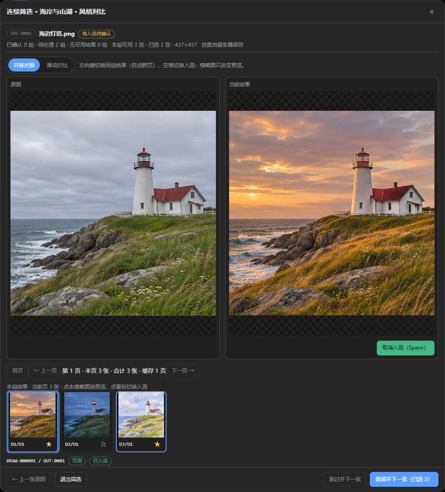
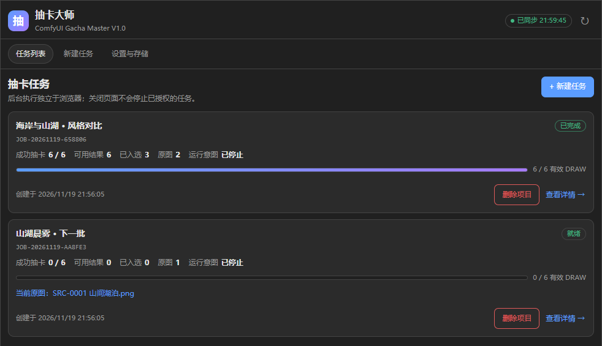
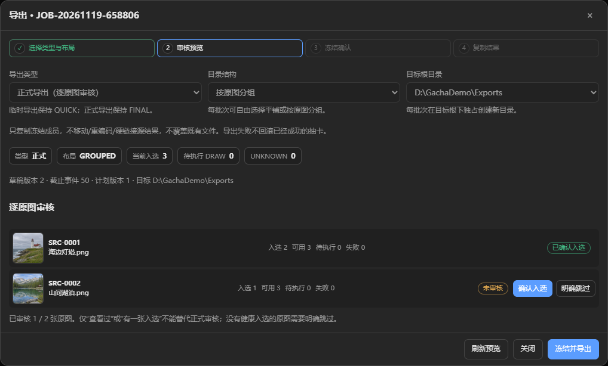

# ComfyUI 抽卡大师 · Gacha Master

用你已有的 ComfyUI 图生图工作流，为多张原图批量生成候选。在侧栏查看任务进度，逐组对照挑图，再一次导出入选结果。

**V1.0 预览版**

[安装](#安装) · [使用](#使用) · [更新与卸载](#更新与卸载) · [常见问题](#常见问题) · [示例工作流](examples/README.md)

## 主要功能

### 逐组对照，挑出想保留的图

把原图和候选并排查看，也可以拖动滑块对比。点缩略图切换候选，点星标入选，同组可以保留多张。筛选位置和入选记录会保存，重启后可接着挑图。



*界面截图使用灯塔和山湖演示素材。*

### 批量生成，集中管理任务

上传多张原图或从受控目录导入，设置每张图的抽卡次数，再打开任务开始执行。侧栏任务卡显示进度和入选数量，支持深浅主题和窄面板。运行可安全暂停和恢复，追加抽卡默认「优先执行」。



### 批量导出入选结果

临时导出可直接预览当前入选图。正式导出按原图逐组确认入选或跳过。两种方式都可以把成品平铺到同一目录或按原图分组，复制失败时可以接着导出。



用「存储清理」预览并移除符合条件的未入选结果。删除整个项目需要输入项目名确认，已导出的成品会保留。

## 安装

### 环境要求

- 已能正常运行的本地 ComfyUI 和图生图工作流。
- Python 3.10 或更高版本，使用 **ComfyUI 自己的 Python 环境**。
- 已安装 Git。
- ComfyUI 环境中已有 Pillow 和 aiohttp；本插件目前不新增第三方运行依赖。

已在 **Windows + ComfyUI 0.45.0** 的隔离实例中验证核心流程；其他版本和复杂自定义工作流需要先做小规模兼容验证。前端使用原生 JavaScript/CSS，克隆后即可加载。

### 通过 Git 安装

先停止 ComfyUI，在 PowerShell 或终端进入它实际使用的 `custom_nodes` 目录：

```powershell
# 将路径换成你的实际 ComfyUI 路径
cd "D:\ComfyUI\custom_nodes"
git clone https://github.com/DDAHAO/ComfyUI-Gacha-Master.git
```

Windows 便携版对应的目录通常是 `ComfyUI_windows_portable\ComfyUI\custom_nodes`。安装后的结构应为：

```text
ComfyUI/
└─ custom_nodes/
   └─ ComfyUI-Gacha-Master/
      ├─ __init__.py
      ├─ requirements.txt
      └─ comfyui_gacha_master/
```

重启 ComfyUI，刷新浏览器，在侧栏打开 **“抽卡大师 / Gacha Master”**。启动日志应出现 `Gacha Master routes registered`。

`requirements.txt` 当前只有依赖说明，无需额外安装运行依赖。遇到缺包时，先确认 ComfyUI 环境完整，再仅在该环境中补齐缺少的包。

> 如果目标位置已有复制版或目录链接，先停止 ComfyUI，将旧插件目录移到 `custom_nodes` 之外备份，再进行 Git 安装。插件只保留一份，任务数据目录继续保留。

通过 Git 安装无需注册 Comfy Registry；本项目目前未发布到 Registry，暂不提供 Manager 搜索安装保证。

### 开发目录安装（可选）

需要让外部开发目录直接连接到 ComfyUI，或使用带代码备份的复制安装时，可在本仓库根目录运行：

```powershell
# 使用 ComfyUI 对应的 Python；路径替换为实际位置
python tools/install_plugin.py --comfy-root "D:\ComfyUI"

# 显式复制安装
python tools/install_plugin.py --comfy-root "D:\ComfyUI" --mode copy
```

Git 安装通过 Git 更新；复制安装通过该工具的 `--mode copy --update` 更新。具体操作见 [运行与维护](docs/OPERATIONS.md)。

## 使用

1. **准备工作流**：先在 ComfyUI 原生界面跑通图生图工作流。选择一个标准 `LoadImage` 和一个最终 `SaveImage`，采样器的 `seed` 或 `noise_seed` 使用直接数值。
2. **创建任务**：打开侧栏 → “新建任务”，按“工作流 → 原图 → 参数 → 检查创建”完成四步向导。首次建议每张只抽 1 次。
3. **开始执行**：创建成功后，在任务详情点击“开始 / 继续”。运行时可安全暂停。追加抽卡默认优先执行，也可以选择排到末尾。
4. **对照筛选**：点击结果缩略图或“连续筛选”，逐组查看原图和结果。星标切换入选，同组可以保留多张；用“保留并下一张”或“跳过并下一张”确认本组。
5. **继续筛选**：关闭页面或重启 ComfyUI 后，打开任务点击“继续筛选”。筛选位置与入选记录保存在服务器数据库中。
6. **导出结果**：选择临时或正式导出、平铺或分组，检查预览并确认。正式导出需要逐组完成审核。
7. **释放空间**：任务详情中打开“存储清理”，检查候选与保护项，再明确确认。清理会永久删除符合条件的结果文件，操作前请确认备份。
8. **删除项目**：在任务列表的项目卡片点击“删除项目”，输入项目名称并确认。项目记录、快照和项目内的全部生成图片会永久删除，已导出文件和项目外的原图会保留。请先暂停运行中的任务，等待当前执行和导出结束。

示例图片和工作流见 [examples](examples/README.md)，模型名称需要替换为本机实际模型。快捷操作包括方向键切换、空格或星标切换入选，以及并排 / 滑动对比；具体以界面提示为准。

## 更新与卸载

更新前，先结束当前操作、停止 ComfyUI，并备份下文的数据目录：

```powershell
git -C "D:\ComfyUI\custom_nodes\ComfyUI-Gacha-Master" pull --ff-only
```

更新完成后重启 ComfyUI 并刷新浏览器。若 Git 提示本地改动或分支冲突，先保存修改并处理冲突。

卸载时，停止 ComfyUI，将插件目录从 `custom_nodes` 移出即可。任务数据、结果、导出和备份保存在独立目录中；需要继续使用时应保留它们。

数据库会执行增量迁移；**切回旧代码不等于回退数据库**。代码回退与数据库恢复步骤见 [运行与维护](docs/OPERATIONS.md)。

## 数据与备份

实际安装时，数据存放在 ComfyUI 配置的用户目录和输出目录中：

```text
<COMFY_USER>/gacha_master/           配置、数据库、原图快照、收据、清理日志与备份
<COMFY_OUTPUT>/gacha_master/Jobs/    结果图片与任务清单
<COMFY_OUTPUT>/gacha_master/Exports/ 默认导出目录
```

引用模式还依赖原图所在目录；自定义导出位置需要另行备份。完整保留任务时，应同时保存用户数据目录、结果目录和相关原图 / 导出文件。更新插件代码与任务数据分开管理。

## 兼容范围与当前限制

- 当前绑定一个标准 `LoadImage` 和一个最终 `SaveImage`；额外保存节点保留原行为并给出提示。子图绑定、动画 / 多帧图片和任意随机自定义节点不在当前支持范围。
- 本地单用户使用；不提供远程多用户权限隔离。
- 核心抽卡、筛选和导出流程已有隔离真实 ComfyUI / GPU 验证；**2026-11-17 新增存储清理流程的最新验证范围是隔离测试与浏览器测试，真实 ComfyUI / GPU 清理流程尚未验证**。
- 真实磁盘写满、物理断电耐久性以及用户实际生产工作流尚未完成验证。首次接入自己的模型和节点组合时，请先运行小任务并核对结果。
- 定向取消默认关闭，需要在目标实例验证后显式开启；执行结果未知时进入人工核验流程。

完整边界见 [已知问题](docs/KNOWN-ISSUES.md) 与 [公开版本说明](docs/PUBLICATION.md)。

## 常见问题

**重启后没有侧栏入口**：检查插件目录是否多套了一层，检查启动日志中的 `IMPORT FAILED` 或路由注册错误，再刷新浏览器。确认加载的是实际运行实例的 `custom_nodes`。

**创建后没有生成**：创建与开始是两个步骤。在任务详情点击“开始 / 继续”，并查看预检或恢复提示。

**工作流预检失败**：确认已在原生 ComfyUI 跑通，选择了正确的输入 / 最终保存节点，模型和自定义节点已安装，种子使用直接数值。

**重启后任务要求核验**：先查看恢复面板，按证据处理未知执行，再显式继续；筛选断点可从“继续筛选”进入。

**旧安装目录无法 `git pull`**：复制安装和目录链接不一定是 Git 仓库。按上文迁移为 Git 安装，或继续用安装器维护复制版。

报告问题请提供 ComfyUI / Python 版本、插件提交号、复现步骤和脱敏日志。提交号可用 `git rev-parse --short HEAD` 查看。请在 [GitHub Issues](https://github.com/DDAHAO/ComfyUI-Gacha-Master/issues) 反馈。

## 开发与验证

开发测试使用单独的虚拟环境。安装测试依赖与 Node.js 后，在仓库根目录运行：

```powershell
python -m venv .venv
.\.venv\Scripts\python.exe -m pip install "Pillow>=10.1.0" "aiohttp>=3.11.8"
.\.venv\Scripts\python.exe tools/run_regression.py --output-dir test-artifacts/regression
```

执行器运行 Python 单元 / 集成 / 故障注入测试和 Node.js 测试，并拒绝空测试集。公开仓库包含测试、工具、合成示例和界面演示图。原始验收截图、运行日志、数据库、生成结果和模型保留在本机。

- [公开版本与本次发布验证](docs/PUBLICATION.md)
- [运行与维护](docs/OPERATIONS.md)
- [API](docs/API.md) · [架构](docs/ARCHITECTURE.md)
- [测试报告](docs/TEST-REPORT.md) · [已知问题](docs/KNOWN-ISSUES.md)
- [更新记录](CHANGELOG.md) · [历史开发首页](docs/README-HISTORY-20261117.md)

历史开发文档中的 `test-artifacts/...` 指开发机上的本地证据路径；具体环境与数据来源以各项记录为准。

## 授权与第三方说明

本仓库目前尚未选择开源许可证；公开源码不替代正式许可证。具体使用授权与第三方组件说明见 [LICENSE-NOTICE.md](LICENSE-NOTICE.md)。仓库不附带 ComfyUI、模型或用户图片。
